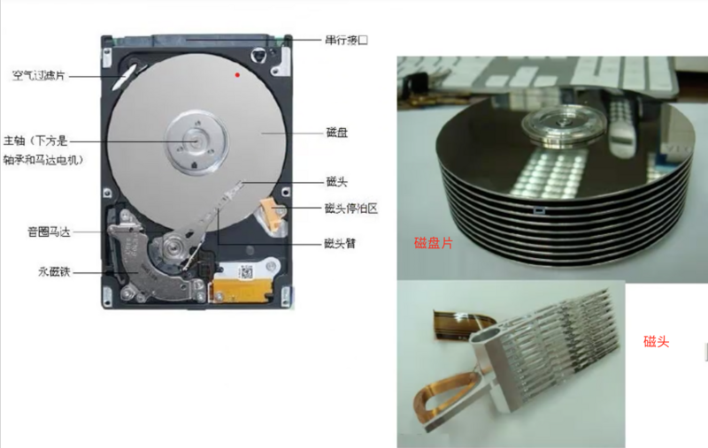
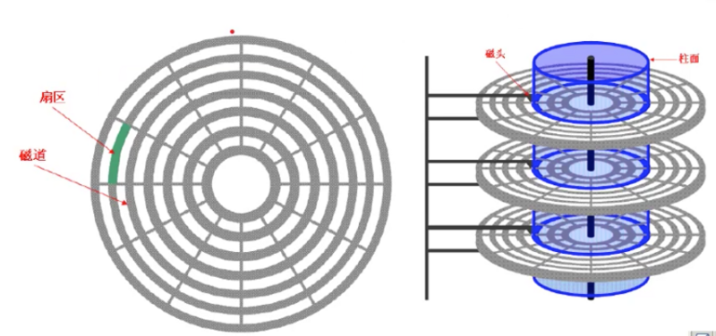
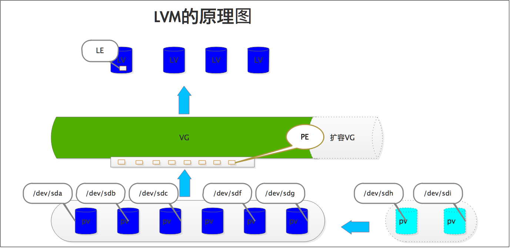
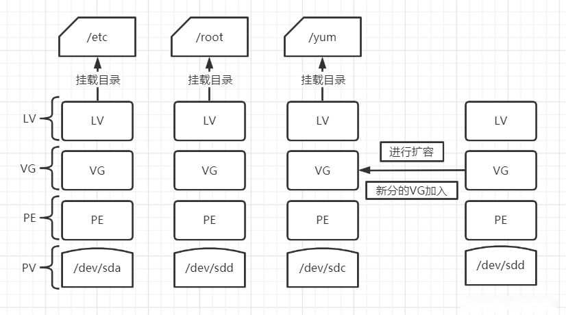

# Linix操作系统磁盘管理


[TOC]


# 一、硬盘介绍

文件系统是Linux系统的核心，在Linux系统中，一切皆文件。对于开发者而言，编程过程中通常用到的是文件IO。在open函数打开文件，read函数读取文件的过程底层原理如何？本文件系统系列文章主要尝试针对的是这部分内容进行深入的讲解。

文件最终是存储在磁盘上，文件的存取，最终是读写磁盘。

## 1、硬盘的物理结构

### 1.1、硬盘结构



其中：

*   每个盘片有两面，两面都可以存储数据。
*   每个盘面都有一个磁头，用于存取数据。
*   所有磁头都是固定的，一起做物理移动。但是每次只有一个磁头执行存取数据的任务，选择使用哪个磁头是由系统控制的。磁头间的切换非常迅速，而磁头摆动寻道则比较慢。
*   磁头摆动，找到要读取数据所在的磁道；盘片通过转动，将数据“送到”磁头下。

### 1.2、磁头数、磁道、柱面、扇区



*   **磁头数：** 每个盘面都有一个磁头，因此磁头数 = 盘面数。
*   **磁道：** 上以盘片轴心为圆心，不同半径的同心圆称为磁道，磁道不是真正肉眼可看见的一道一道“坑”，而是被磁盘上被磁化的区域，磁道之间有一定的间隙，以免磁道之间磁介质相互影响。
*   **扇区：** 每个磁道被等分为若干个弧段（扇区），每个扇区可以存放512个字节的数据。**扇区是磁盘驱动器向磁盘读写数据的最小单元。**
*   **柱面：** 不同盘片半径相同的磁道组成的一个“柱面”。

## 2、CHS编号

所谓硬盘的CHS，即Cylinder（柱面）、Head（磁头）、Sector（扇区）。每个柱面、磁头、扇区都有自己的编号。

### 2.1、磁道编号规则

*   **磁头编号：** 从上到下，分别为磁头0号，磁头1号......
*   **柱面编号：** 最外圈的柱面编号为0，往里依次递增1，2，3.....

### 2.2、扇区编号规则

每个磁道都可以被分为若干个扇区，假设有18个扇区，编号依次为1，... 18。这里的1...18在一个磁道中是唯一的，但不同磁道之间会重复。因此，要确定一个扇区在硬盘（多个盘片）中的具体位置，则需要结合柱面号/磁头号/扇区号来确定——绝对扇区编号，或者是为整个硬盘的所有扇区分配一个唯一的编号——DOS扇区编号（也称为相对扇区编号或逻辑扇区编号）。

*   **绝对扇区：** 由柱面号/磁头号/扇区号唯一确定。
*   **DOS（Disk Operating System）扇区（逻辑扇区）：** 磁盘操作系统为了管理方便，会将_柱面号/磁头号/扇区号_确定的扇区编号转换为易于管理和计算的单一数字编号，称为相对扇区编号或逻辑扇区编号。DOS扇区编号是从柱面0/磁头0/扇区1开始的，编号为0，依次递增，即柱面0/磁头0/扇区18的DOS扇区编号为18；柱面0/磁头1/扇区1的DOS扇区编号为19...。每个分区的第一个扇区的逻辑扇区编号为0。

### 2.3、通过CHS计算硬盘容量

硬盘存储容量＝磁头数×柱面数×每个磁道扇区数×每个扇区字节数

## 3、磁盘存储划分

### 3.1、第一个扇区存储的数据

硬盘的第一个扇区（逻辑编号为0）可以说是整个硬盘最重要扇区了，它主要存储两大信息：

*   **主引导分区（Master Boot Record，MBR）：** 存放引导加载程序，大小为446字节。
*   **分区表（partition table）：** 记录整块硬盘分区的状态，占64字节。

### 3.2、硬盘分区

分区的最小单位为柱面（Cylinder），也就是说，分区其实就是指定从第几个柱面到第几个柱面属于哪个区。

假设硬盘有400个柱面，平均分为4个区（C、D、E、F盘），则第四个分区F的柱面范围是第301号到第400号柱面。

分区表中，记录的就是就是每个分区的起始柱面号和结束柱面号。因为分区表只有64字节，因此最多只能容纳4个分区的记录（硬盘默认），要想分更多的去，则需要通过扩展分区来创建逻辑分区。

## 4、开机流程

1.  **加载BIOS：** BIOS（Base Input Output System，基本输入输出系统，读做/'baious/）是硬件厂商写入到主板ROM里的一个程序，电脑开机时，会最先执行BIOS。

2.  **MBR：** BIOS在执行的过程中，会根据用户设置（即在BIOS的Boot界面选择的优先启动项，U盘/硬盘/光驱），如果硬盘的优先级最高，则计算机会从硬盘的第一个扇区的MBR中的读取引导加载程序（Boot Loader）。和**BIOS**一样，主引导分区MBR是硬件本身会支持的东西。
3.  **引导加载程序：**引导加载程序（Boot Loader）是用于读取操作系统内核文件的一个小软件，不同的操作系统有各自的引导加载程序。每个分区都可以有自己的文件系统，有自己的引导扇区，在启动的过程中，用户可以选择是直接加载引导程序所在分区的操作系统，还是将引导加载功能交给各分区引导扇区中的加载程序。boot loader的功能主要有：

    - 提供菜单：让用户选择不同的开机选项，是多重引导的重要功能。
    - 载入内核文件：直接指向可开机的程序区段，开始操作系统。
    - 转交其他loader: 将引导加载功能转交给其他loader负责。
4.  **操作系统内核文件：**最后，引导加载程序加载操作系统的内核文件，启动操作系统！

## 5、要点

1.  每个分区都有自己的引导扇区（boot sector）。
2.  实际可开机的操作系统内核文件是存放在各个分区内的，如在C盘安装Windows系统，在D盘安装Linux操作系统。
3.  引导加载程序（boot loader）只会认识自己所在分区内的可开机内核文件，以及其他boot loader（相当于一个指针，指向其他loader）。
4.  loader可以直接指向或者间接地讲管理权交给其他loader。
5.  一点经验：如果要安装多系统，最好先安装Windows，后安装Linux。因为Windows会强制覆盖MBS，也就是说，如果你先装Linux再装Windows，MBR中就只有Windows的相关选项（Linux的被覆盖掉了）。而Linux则不会强制覆盖MBR，你可以选择将Linux的引导程序安装在MBR或者其所在分区的引导扇区中；你也可以在Linux的引导程序中设置Windows的开机选项。

## 6、磁盘存储数据的形式

磁盘以二进制的形式存储数据。我们平时编程过程中读写文件模式可能有文本形式/二进制形式，文件也有文本文件、音频文件、图片文件...等各种不同类型的文件，但这些文件在磁盘上都是以二进制的方式存储。

可以想像一下，二进制中的0，对应磁盘上的一个“凹”点，1对应磁盘上的一个“凸”点。

# 二、Linux文件系统


计算机的文件系统是一种存储和组织计算机数据的方法，它使得对其访问和查找变得容易，文件系统使用文件和树形目录的抽象逻辑概念代替了硬盘和光盘等物理设备使用数据块的概念，用户使用文件系统来保存数据不必关心数据实际保存在硬盘（或者光盘）的地址为多少的数据块上，只需要记住这个文件的所属目录和文件名。在写入新数据之前，用户不必关心硬盘上的那个块地址没有被使用，硬盘上的存储空间管理（分配和释放）功能由文件系统自动完成，用户只需要记住数据被写入到了哪个文件中。

文件系统的本质：一种方便管理、组织、访问数据的软件。

- 对于管理来说，主要是磁盘空闲空间的管理
- 对于组织来说，主要是通过引入文件（inode）、树形目录（dentry）来组织用户的数据。文件包含用户的数据、树形为用户提供了一个对数据进行分类的功能。
- 对于访问来说，通过目录+文件名的方式进行文件创建、删除、读、写（也就是所谓的增、删、查、改）。


## 1、根文件系统

  根文件系统（rootfs）是内核启动时所 mount(挂载)的第一个文件系统，内核代码映像文件保存在根文件系中，而系统引导启动程序会在根文件系统挂载之后从中把一些基本的初始化脚本和服务等加载到内存中去运行。 

## 2、虚拟文件系统

  虚拟文件系统VFS软件抽象层为用户屏蔽了底层文件系统的差异，向上层提供了统一地访问接口。

## 3、真文件系统

  真文件系统其实是实际存储设备的文件系统，挂载于EEPROM、 Nor FLASH、 NAND FLASH、 eMMC 等存储器中。

### 3.1、ext4

EXT4是第四代扩展文件系统（Fourth extended filesystem，缩写为 ext4）是Linux系统下的日志文件系统,使用64位空间记录块数量和i-节点数量。

### 3.2、xfs

XFS最早针对IRIX操作系统开发，是一个高性能的日志型文件系统，能够在断电以及操作系统崩溃的情况下保证文件系统数据的一致性。它是一个64位的文件系统，后来进行开源并且移植到了Linux操作系统中，目前CentOS 7将XFS+LVM作为默认的文件系统。据官方所称，XFS对于大文件的读写性能较好。

## 4、伪文件系统

  Linux内核提供了sysfs、procfs、devtmpfs等伪文件系统，伪文件系统存在于内存，不占用硬盘。以文件地形式向用户提供一些系统信息，用户读写这些文件就可以读取、修改系统的一些信息。

### 4.1、procfs

  procfs是 进程文件系统的缩写，包含一个伪文件系统（启动时动态生成的文件系统），用于通过内核访问进程信息。这个文件系统通常被挂载到 /proc 目录。  

  由于 /proc 不是一个真正的文件系统，它也就不占用存储空间，只是占用有限的内存。

### 4.2、devtmpfs

  devtmpfs 的功用是在 Linux 核心 启动早期建立一个初步的 /dev，令一般启动程序不用等待 udev（udev 是Linux kernel 2.6系列的设备管理器。它主要的功能是管理/dev目录底下的设备节点。），缩短 GNU/Linux 的开机时间。  

  如果将一个设备连接到Linux系统时，通常需要一个设备驱动程序才能正常工作。此时通过设备文件或设备节点与设备驱动程序交互，这些是看起来像普通文件的特殊文件。由于这些设备文件就像普通文件一样，所以可以使用ls、cat等程序与它们交互。这些设备文件一般存放在/dev目录下。

### 4.3、sysfs

  sysfs是一个基于内存的文件系统，它的作用是将内核信息以文件的方式提供给用户程序使用。sysfs 文件系统被挂载在 /sys 挂载点上。  

  Sysfs的目的是更好地管理系统上的设备，相比/dev目录无法做到这一点。Sysfs是一个虚拟文件系统，通常挂载在/sys目录下。它为我们提供了比在/dev目录中能够看到的更详细的信息。目录/sys和/dev在某些方面看起来非常相似，但它们确实有很大的不同。基本上，/dev目录很简单，它允许其他程序访问设备本身，而/sys文件系统用于查看信息和管理设备。  

  /sys文件系统基本上包含了系统中所有设备的所有信息，比如制造商和型号、设备插入的位置、设备的状态、设备的层次结构等等。在这里看到的文件不是设备节点，因此实际上并不是在/sys目录下与设备交互，而是在管理设备。

# 三、磁盘分区与挂载

**磁盘热扫描：**

```bash
cd  /sys/class/scsi_host
for i in `ls /sys/class/scsi_host`;do echo "- - -" > ${i}/scan;done
```

## 1、磁盘分区方式

### MBR

        主引导记录，支持四个主分区或三主一扩展多个逻辑，每分区最大2TB，兼容性好。

        fdisk /dev/sdb p: 显示当前硬件的分区，包括没有保存的改动 n: 创建一个新的分区 d：删除一个分区 w: 保存并退出 q: 不保存退出 t: 修改分区类型（文件系统类型） l: 显示所支持的所有类型

### GPT

        是GUID分区表（GUID Partition Table）的缩写; 含义为“全局唯一标识磁盘分区表”，是一个实体硬盘的分区表的结构布局的标准。 自纠错能力强，一块磁盘上主分区数量不受（4个的）限制，支持大于18EB的总容量， 几乎没有上限，最大支持到128个分区，分区大小支持到256TB。

        gdisk /dev/sdc p: 显示当前硬件的分区，包括没有保存的改动 n: 创建一个新的分区 d：删除一个分区 w: 保存并退出 q: 不保存退出 t: 修改分区类型（文件系统类型） l: 显示所支持的所有类型

## 2、分区命令

### 2.1、fdisk命令

**语法：**

```bash

```

**选项：**

| 选项 | 作用 |
| ---- | ---- |
|      |      |
|      |      |
|      |      |

**案例：**

### 2.2、parted命令

**语法：**

```bash

```

**选项：**

| 选项 | 作用 |
| ---- | ---- |
|      |      |
|      |      |
|      |      |

**案例：**

## 3、查看与识别命令

### 3.1、lsblk命令

**语法：**

```bash

```

**选项：**

| 选项 | 作用 |
| ---- | ---- |
|      |      |
|      |      |
|      |      |

**案例：**

### 3.2、partprobe命令

**语法：**

```bash

```

**选项：**

| 选项 | 作用 |
| ---- | ---- |
|      |      |
|      |      |
|      |      |

**案例：**

## 4、挂载命令

### 4.1、mount命令

**语法：**

```bash

```

**选项：**

| 选项 | 作用 |
| ---- | ---- |
|      |      |
|      |      |
|      |      |

**案例：**

### 4.2、umount命令

**语法：**

```bash

```

**选项：**

| 选项 | 作用 |
| ---- | ---- |
|      |      |
|      |      |
|      |      |

**案例：**

# 四、LVM逻辑卷

## 1、概述

LVM 是 Logical Volume Manager（逻辑卷管理）的简写，它是 Linux 环境下对磁盘分区进行管理的⼀种机制; 安装 Linux 操作系统时遇到的⼀个常见的难以决定的问题就是如何正确地评估各分区大小，以分配合适的硬盘空 间; 普通的磁盘分区管理方式在逻辑分区划分好之后就无法改变其大小; 随着 Linux 的逻辑卷管理功能的出现，这些问题都迎刃而解，用户在无需停机的情况下可以方便地调整各个分区大小，即动态调整磁盘容量，从而提高磁盘管理的灵活性。

### 1.1、运行原理




### 1.2、LVM 相关概念：

**1.PV(Physical Volume)：物理卷**

处于 LVM 最底层，可以是物理硬盘或者分区，整个硬盘，或使用fdisk 等⼯具建⽴的普通分区，包许多默认 4MB 大小的 PE（Physical Extent，基本单元）。

**2.PE(Physical Extend)：物理区域**

PV 中可以用于分配的最小存储单元，可以在创建 PV 的时候制定（默认为 4MB），如 1M, 2M, 4M, 8M, 32M, 64M… 组成同⼀VG 中所有 PV 的 PE大小应该相同。

**3.VG(Volume Group)：卷组**

建立在 PV 之上，可以含有一个到多个 PV，一个或多个物理卷组合而成的整体。

**4.LV(Logical Volume)：逻辑卷**

建立在 VG 之上，相当于原来分区的概念，不过大小可以动态改变。从卷组中分割出的一块空间，用于建立文件 系统。

### 1.3、挂载流程



## 2、管理命令

| 功能 | PV物理卷命令 | VG卷组命令 | LV逻辑卷命令 |
| ---- | ------------ | ---------- | ------------ |
| 扫描 | pvscan       | vgscan     | lvscan       |
| 建立 | pvcreate     | vgcreate   | lvcreate     |
| 查询 | pvdisplay    | vgdisplay  | lvdisplay    |
| 删除 | pvremove     | vgremove   | lvremove     |
| 扩容 |              | vgextend   | lvextend     |
| 缩容 |              | vgreduce   | lvreduce     |

## 3、配置案例

### 3.1、构建LVM逻辑卷

```bash
#创建分区
fdisk /dev/sdb	
#创建物理卷
pvcreate /dev/sdb1 /dev/sdb2 /dev/sdb3
#创建卷组
vgcreate testvg /dev/sdb1 /dev/sdb2 /dev/sdb3
#创建逻辑卷
lvcreate -n tstlv testvg -L 5G 
```

### 3.2、扩容LVM逻辑卷

```bash

```

### 3.3、缩容LVM逻辑卷

```bash

```


# 五、磁盘配额

## 1、概述

针对用户和组，用于配置用户和组在该磁盘的使用容量限制。

**配额类型：**

- usrquota:支持对用户的磁盘配额
- grpquota：支持对组的磁盘配额

**限制类型：**

- 软限制：指定一个软性的配额数据值，用户超过这个数据时，系统给出警告信息，可以打破数据值。
- 硬限制：指定一个硬性的配额值，禁止用户超过这个限制。

## 2、配置命令

### 2.1、quota命令

**语法：**

```bash

```

**选项：**

| 选项 | 作用 |
| ---- | ---- |
|      |      |
|      |      |
|      |      |

**案例：**

### 2.2、xfs_quota命令

**语法：**

```bash

```

**选项：**

| 选项 | 作用 |
| ---- | ---- |
|      |      |
|      |      |
|      |      |

**案例：**


## 3、配置案例

```bash
#针对用户和组，用于配置用户和组在该磁盘的使用容量限制。
#实现支持磁盘配额的挂载：
mount -o ursquota,grpquota /dev/test_vg/test_lv /testlvm
#查看是否支持磁盘配额：
mount
#XFS文件系统的磁盘配额命令：
xfs_quota -x -c 'limit -u bsoft=10M bhard=50M isoft=10 ihard=20 lisi' /testlvm/
#-u：用户配额
#-g：组配额
#（b/i）soft：容量/文件数软限制，用于监视
#（b/i）hard：容量/文件数硬限制，不能超出设置的值
#查看容量配额：
xfs_quota -x -c 'report  -b -u ' /testlvm/
#查看文件数量配额：
xfs_quota -x -c 'report  -i -u ' /testlvm/
#在终端中切换用户的命令：
su - username
#验证：
dd if=/dev/zero of=./test.txt bs=10M count=60
mkdir dir{1..30}
```

### 3.1、xfs配额

1、挂载并启用配额

```cobol
mount -o usrquota,grpquota /挂载磁盘 /挂载点
```

永久挂载参数如下：

```cobol
/dev/sdb1 /mail xfs defaults,usrquota,grpquota 0 0
```

2、编辑用户配额

```cobol
xfs_quota -x -c 'limit -u bsoft:30M bhard:50M isft:3 ihard:5 用户名' /挂载目录
```

3、也可以针对组编辑配额

```cobol
xfs_quota -x -c 'limit -g bsoft:30M bhard:50M isft:3 ihard:5 组名' /挂载目录
```

### 3.2、ext4配额

1、挂载

```cobol
mount -o defaults,usrquota,grpquota /挂载磁盘 /挂载点
```

永久挂载参数如下：

```cobol
/dev/sdb1 /mail ext4 defaults,usrquota,grpquota,defaults 0 0
```

2、生成配额文件

```cobol
quotacheck /挂载点
```

3、启用配额；关闭配额命令用quotaoff

```cobol
quotaon -ugv /挂载点
```

4、针对用户配额

```undefined
edquota -u 用户名
```

        也可以针对组做配额： edquota -g 组名

5、修改配置文件格式如下：

```cobol
/dev/sdd1 0 30M 50M 0 8 10
```


# 六、磁盘检测与修复

## 1、fsck命令

**语法：**

```bash

```

**选项：**

| 选项 | 作用 |
| ---- | ---- |
|      |      |
|      |      |
|      |      |

**案例：**

## 2、xfs-repair命令

**语法：**

```bash

```

**选项：**

| 选项 | 作用 |
| ---- | ---- |
|      |      |
|      |      |
|      |      |

**案例：**

## 3、badblocks命令

**语法：**

```bash

```

**选项：**

| 选项 | 作用 |
| ---- | ---- |
|      |      |
|      |      |
|      |      |

**案例：**

# 七、文件系统备份与恢复

## 1、xfsdump命令

**语法：**

```bash

```

**选项：**

| 选项 | 作用 |
| ---- | ---- |
|      |      |
|      |      |
|      |      |

**案例：**

## 2、xfsrestore命令

**语法：**

```bash

```

**选项：**

| 选项 | 作用 |
| ---- | ---- |
|      |      |
|      |      |
|      |      |

**案例：**