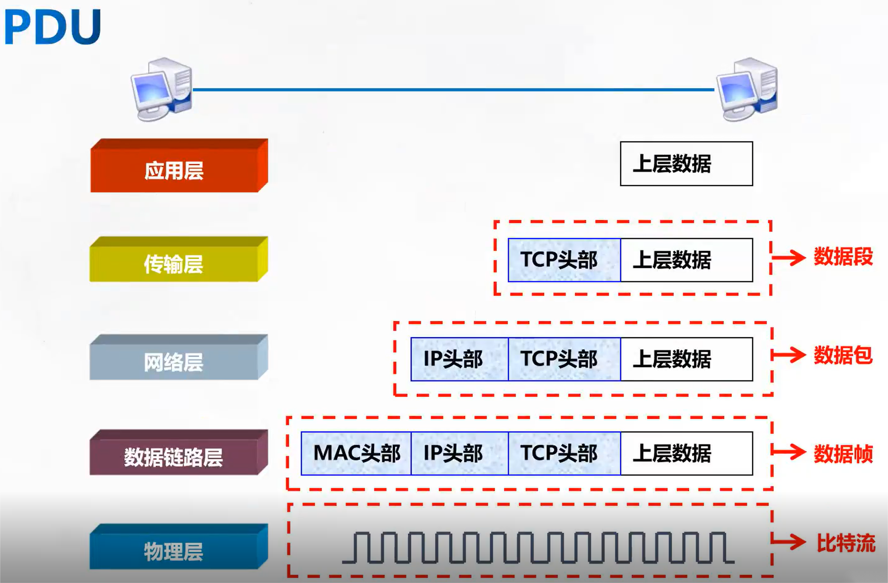
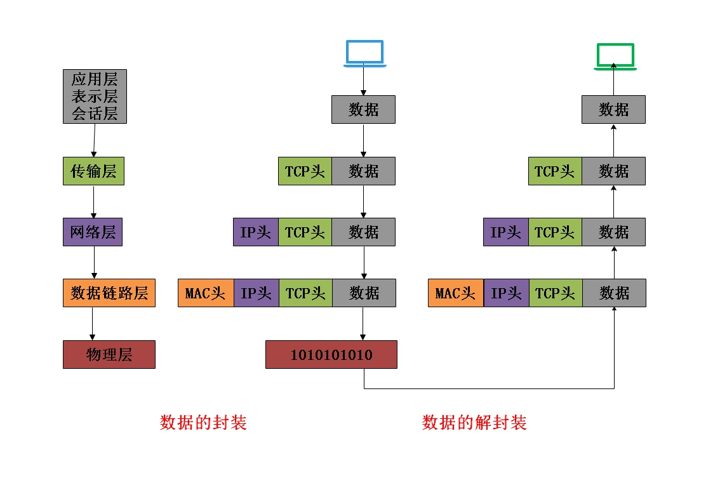
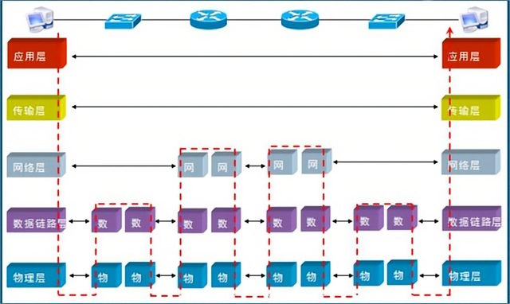

# 计算机网络技术

[TOC]

# 一、网络概述

## 1、网络的概念

两个不在同一地理位置的主机，通过传输介质和通信协议，实现通信和资源共享。

## 2、网络发展史

- 计算机网络发展的第一个阶段（60年代）

  - 标志性的事件：ARPANET

  - 关键技术：分组交换

- 计算机网络发展的第二个阶段（70-80年代）

  - 标志性的事件：NSFNet

  - 关键技术：TCP/IP

- 计算机网络发展的第三个阶段（90年代）

  - 标志性的事件：浏览器Mosaic

  - 关键技术：Web技术

## 3、网络的四要素：

- 传输介质：同轴线缆，光纤，双绞线，无线电波等
- 通信协议：设备之间的语言，比如——eigrp，rip，OSPF，is-is，BGP，TCP，ip，ppp等
- 资源：数据，图片，视频，音频
- 终端：手机，笔记本，平板，台式机等

## 4、网络功能

- 数据通信
- 资源共享
- 增加可靠性
- 提高系统处理能力

## 5、网络类型

- WAN（Wide Area Network）广域网（外部网络）

  - 范围：几十到几千千米 

  - 作用:用于连接远距离的计算机网络

  - 典型应用:Internet，MAN(Metropolitan Area Network)

- LAN(Local Area Network)局域网（内部网络）

  - 范围：1km左右 

  - 作用:用于连接较短距离内的计算机

  - 典型应用:企业网,校园网

## 6、网络协议与标准

- 协议

  - 语法
    - 多个对象之间协商的一个接口对象

  - 语义
    - 解释控制信息每个部分的意义。它规定了需要发出何种控制信息，以及完成的动作与做出什么样的响应。

  - 同步
    - 以多字节或多比特组成的数据块为传送单位，仅在帧的起始处同步，帧内维持固定的时钟。

- 标准

​	大家一致认同的协议

## 7、网络中常见概念

| 编号 | 概念         | 说明                                                         |
| ---- | ------------ | ------------------------------------------------------------ |
| 1    | 主机         | 也称端系统，上任何一种能够连接网络的设备。                   |
| 2    | 通信链路     | 由物理链路（同轴电缆、双绞线、光纤等）连接到一起组成的一种物理通路。 |
| 3    | 路由器       | 和链路层交换机一样，都属于交换机，主要用于转发数据。         |
| 4    | 分组         | 当一台端系统向另外一台端系统发送数据时，通常会将数据进行分片，然后为每段加上首部字节，从而形成分组。这些分组通过网络发送到端系统，然后再进行数据处理。 |
| 5    | 路径         | 一个分组所经历的一系列通信链路和分组交换机称为通过这个网络的路径。 |
| 6    | 因特网服务商 | ISP。网络运营商，联通、移动等。                              |
| 7    | 网络协议     | 计算机网络中为进行数据交换而建立的规则、标准或者约定。       |
| 8    | IP           | 网际协议。规定了路由器和端系统之间发送和接收的分组格式。     |
| 9    | TCP/IP协议簇 | 以TCP、IP协议为主的一系列协议。ICMP协议、ARP协议、UDP协议、DNS协议、SMTP协议等。 |
| 10   | 套接字接口   | 指的就是socket接口，规定了端系统之间通过因特网进行数据交换的方式。 |
| 11   | 协议         | 协议定义了两个以上通信实体之间交换报文格式和顺序所遵从的标准。 |
| 12   | 丢包         | 在计算机网络中是指分组出现丢失的现象。                       |
| 13   | 吞吐量       | 单位时间内成功传输数据的数量。                               |
| 14   | IP地址       | 网络协议地址，在互联网中唯一标识主机的一种地址。每台入网的设备都有一个IP地址，又分为内网IP和公网IP。 |
| 15   | 端口号       | 在同一台主机内，端口号用于标识不同应用程序进程。             |
| 16   | URI          | uniform resource identifier，统一资源标识符。                |
| 17   | URL          | uniform resource locator，统一资源定位符，URI的子集。        |
| 18   | HTML         | hyper text markup language，超文本标记语言。一种用于创建网页的标准标记语言，通过一系列标签将网络上的文档格式统一，使分散的Internet资源连接为一个逻辑整体。 |
| 19   | web页面      | web page，由页面上的很多对象组成。                           |
| 20   | web服务器    | web server，可以向浏览器等web客户端提供文档，也可以放置网站文件、数据文件，供全世界浏览和下载。主流的有Apache、Nginx、IIS。 |
| 21   | webservice   | 一种跨编程语言和操作系统平台的远程调用技术。                 |
| 22   | CDN          | content delivery network，内容分发网络。应用了http协议里的缓存和代理技术，代替源站响应客户端的请求。CDN是构建在现有网络基础之上的网络，它依靠部署在各地的边缘服务器，通过中心平台的负载均衡、内容分发、调度等功能模块，使用户就近获取所需内容，降低网络拥塞，提高用户访问响应速度和命中率。 |
| 23   | WAF          | 一种应用程序保护系统，它是一种通过执行一系列针对HTTP/ HTTPS的安全策略来专门为Web应用提供保护的一款产品，它是应用层面的防火墙，专门检测HTTP流量，是防护 Web 应用的安全技术。 |
| 24   | HTTP         | hypertext transfer protocol，超文本传输协议。是一个在计算机世界里专门在两点之间传输文字、图片、音频、视频等超文本数据的约定和规范。 |
| 25   | SMTP协议     | 提供电子邮件服务的协议。主要用于系统之间的邮件新仙尼传递，并提供有关来信的通知。 |
| 26   | DNS协议      | 用于把人类易于记忆的网络地址名称映射为主机能够识别的IP地址。 |
| 27   | TELNET协议   | 远程登录协议，允许用户（Telnet客户端）通过一个协商过程来与一个远程设备进行通信，它为用户提供了在本地计算机上完成远程主机工作的能力。 |
| 28   | SSH协议      | SSH是一种建立在应用层上的安全加密协议。因为TELNET在主机和远程主机的发送数据包的过程中是明文传输，未经任何安全加密，容易被网上不法分子嗅到数据包来搞事情。为了数据的安全性，一般会用SSH进行远程登录。 |
| 29   | FTP协议      | 文件传输协议，是应用层协议之一。包括FTP服务器和FTP客户端。用户可以使用FTP客户端通过FTP协议访问位于FTP服务器上的资源。FTP协议传输效率很高，一般用来传输大文件。 |
| 30   | 单向数据传输 | 数据的流向只能是单向的，也就是从发送端到接收端。             |
| 31   | 双向数据传输 | 数据流向是双向的，又叫全双工通信。                           |
| 32   | 面向连接的   | 指应用进程在向另一个应用进程发送数据前，需要先进行握手，即它们必须先互相发送预备报文段，用来建立确保数据传输的参数。 |
| 33   | 三次握手     | TCP连接的建立需要经过三个报文段的发送，这种连接的建立过程被称为三次握手。 |
| 34   | 四次挥手     | TCP断开连接需要经过四个报文段的发送，这种断开过程是四次挥手。 |
| 35   | IPv4         | 网际协议的第四个版本，使用32位的地址。                       |
| 36   | IPv6         | 网际协议的第六个版本，IPv6的地址长度为128位。IPv6的使用，解决了网络资源地址数量的问题，也解决了多种接入设备连入互联网的障碍。 |
| 37   | 接口         | 主机和物理链路之间的边界。                                   |
| 38   | ARP协议      | 一种解决地址问题的协议。通过IP位线索，可以定位下一个用来接受数据的网络设备的MAC地址。如果目标主机和主机不在同一个链路上时，可以通过ARP查找下一条路由的地址。ARP只适用于IPv4。 |
| 39   | RARP         | 将ARP反过来，通过MAC地址定位IP地址的一种协议。               |
| 40   | 代理ARP      | 用于解决ARP包被路由器隔离的情况，通过代理ARP可以实现将ARP请求转发给临近的网段。 |
| 41   | ICMP协议     | Internet报文控制协议。如果在IP通信过程中由于某个IP包由于某种原因未能到达目标主机，那么将会发送ICMP消息，ICMP实际上是IP的一部分。 |
| 42   | DHCP协议     | 一种动态主机配置协议。使用DHCP就能实现自动设置IP地址、统一管理IP地址分配，实现即插即用。 |
| 43   | NAT协议      | 网络地址转换协议。指所有本地地址的主机在接入网络时，都需要在NAT路由器上将其转换成全球IP地址，才能和其他主机进行通信。 |
| 44   | IP隧道       | 由路由器把网络层协议封装到另一个协议中从而跨过网络传输到另外一个路由器的过程。 |
| 45   | 单播         | 1对1发送信号。例如早期的固定电话。                           |
| 46   | 广播         | 主机和与他连接的所有端系统相连，主机将信号发送给所有的端系统。 |
| 47   | 多播         | 与广播类似，不同在于多播需要限定在某一组主机作为接收端。     |
| 48   | 任播         | 在特定的多台主机中选出一个接收端的通信方式。                 |
| 49   | IGP          | 内部网关协议，一般用于企业内部自己搭建的路由自治系统。       |
| 50   | EGP          | 外部网关协议，通常用于在网络主机之间相互交换路由信息。       |
| 51   | MPLS         | 一种标记交换技术，会对每个IP数据包都设定一个标记，然后根据这个标记进行转发。 |
| 52   | MAC协议      | 媒体访问控制协议，规定了帧在链路上传输的规则。               |
| 53   | 以太网       | 以太网是一种当今最普遍的局域网技术，它规定了物理层的连线、电子信号和MAC协议的内容。 |
| 54   | VLAN         | 虚拟局域网是一组逻辑上的设备和用户，这些设备和用户并不受物理位置的限制，可以根据功能、部门及应用等因素将他们组织起来，相互之间的通信就好像它们在同一个网段中一样，所以称为虚拟局域网。 |
| 55   | 基站         | 无线网络的基础设施。                                         |

## 8、网络拓扑结构

- 星型拓扑

  - 优点

    - 易于实现

    - 易于网络扩展

    - 易于故障排查

  - 缺点

    - 中心节点压力大

    - 组网成本较高

- 网型拓扑

  - 各个节点至少与其他两个节点相连

  - 可靠性高、组网成本也高

# 二、网络模型

## 1、分层思想

### 1.1、概述

分层思想的核心理念是将复杂的系统或问题划分为多个独立的、相互关联的层级，每个层级有不同的功能和责任。这种分层的方式可以使系统或问题更具结构化和可管理性，简化设计和实施过程，并提高系统或问题的可扩展性和互操作性。

### 1.2、核心理念

- 模块化：将系统或问题划分为多个模块或层级，每个层级负责特定的功能，模块之间相互独立但也相互关联。这样可以降低复杂度，使系统设计更加清晰和可扩展。
- 抽象性：每个层级都对其他层级提供特定的抽象接口，屏蔽了底层实现的复杂性，使各层级之间的交互更加简化和统一。这样可以提高代码的可维护性和可重用性。
- 松耦合：每个层级之间通过抽象接口进行交互，层级之间的耦合度尽可能地降低，使得各个层级可以独立地进行修改和演变。这样可以使系统更具灵活性和可扩展性。
- 可替换性：由于每个层级之间的耦合度较低，所以可以灵活地替换或添加新的功能层级，而不需要对其他层级进行修改。这样可以使系统更容易适应变化的需求和技术。

## 2、OSI七层模型

7. **应用层**

Application Layer

- 作用

应用层为用户提供网络应用和服务，如电子邮件、文件传输、远程登录等。应用层负责处理高层应用程序之间的通信，满足用户的需求，提供与用户的接口

- 数据封装与解封装过程

在发送端，应用层会将数据分割成合适的格式，如HTTP请求或SMTP邮件等。接收端则根据应用层的首部信息，将数据还原为原始格式。这就是应用层的解封装过程。

6. **表示层**

Presentation Layer

- 作用

表示层负责处理数据的表示方式。它将数据从应用程序格式转换为网络格式，并提供数据压缩、加密等服务。表示层还会根据不同的应用需求，对数据进行分组或分割。定义传递信息的语法和语义，编码和解码、压缩解压缩、加密解密

- 数据封装与解封装过程

在发送端，表示层会对数据进行必要的处理，如分割、压缩、加密等。接收端则需要根据表示层的首部信息，将数据还原为原始格式。这就是表示层的解封装过程。

5. **会话层**

Session Layer

- 作用

会话层负责建立、管理和终止会话。它会为会话分配唯一的会话标识符，以确保会话的完整性和可靠性。会话层还负责处理会话之间的数据交换和同步。建立用户间的会话关系

- 数据封装与解封装过程

在发送端，会话层会为数据添加一些会话控制信息，如会话标识符、状态等。接收端则通过识别这些信息，将它们从数据中提取出来，并传递给下一层。这就是会话层的解封装过程。

4. **传输层**

Transport Layer

- 作用

传输层为应用层提供端到端的数据传输服务。它负责将数据分割成更小的单元，如TCP或UDP数据段，并确保它们按照正确的顺序传输到目的地。传输层还负责处理流量控制和错误恢复等问题。用户进程间的通信，承上启下

- 数据封装与解封装过程

在发送端，传输层将为数据添加TCP或UDP的首部，包含序列号、确认号等信息。接收端则通过识别这些信息，将它们从数据段中提取出来，并传递给下一层。这就是传输层的解封装过程。

3. **网络层**

Network Layer

- 作用

网络层负责在整个网络中选择和定位传输路径，处理分组的传输和路由问题。它主要负责IP地址的解析和路由信息的获取，以便将数据从一个网络传输到另一个网络。数据包封装结构，源和目的方的逻辑地址（IP地址），根据包头的逻辑地址选路

- 数据封装与解封装过程

网络层会将数据分割成更小的单元，如IP数据包，并为每个数据包添加一些额外的信息，如IP地址、校验和等。接收端则通过识别这些信息，将它们从数据包中提取出来，并传递给下一层。这个过程就是网络层的解封装过程。

2. **数据链路层**

Data Link Layer

- 作用

数据链路层负责在相邻节点之间提供可靠的数据传输服务。它负责将原始的比特流组成一个个数据帧，并提供流控制和错误检测功能。在数据封装和解封装过程中，数据链路层主要负责添加和删除数据帧的首部和尾部。数据帧封装结构，源和目的方的物理地址（MAC），数据校验功能

- 数据封装与解封装过程

在发送端，数据链路层将数据分割成多个数据帧，并为每个数据帧添加首部和尾部。这些首部和尾部包含了用于传输控制和错误检测的信息。接收端则通过识别这些首部和尾部，将它们从数据帧中提取出来，并传递给下一层。这就是数据链路层的解封装过程。

1. **物理层**

Physical Layer

- 作用

物理层负责在计算机之间传输原始的比特流。它定义了电气、光学和物理接口的特性，以及数据在传输媒介上的传输方式。在数据封装和解封装过程中，物理层主要负责比特流的传输和接收。如何使用物理信号来表示数据1和0，数据传输是否可同时在两个方向上进行，通信双方如何建立和中止连接，物理接口特性

- 数据封装与解封装过程

在发送端，物理层将比特流添加到数据帧的首部，形成一个新的数据单元。这个过程就是数据封装。在接收端，物理层将这个数据单元的首部移除，并传递给下一层。这就是数据解封装。

## 3、TCP/IP五层模型

5. **应用层**

协议

- HTTP | HTTPS
  - 超文本传输协议
  - 检测端口号 80/tcp | 443/tcp
- FTP
  - 文件传输协议
  - 检测端口号21/TCP
- TFTP
  - 简单文件传输协议
  - 检测端口号69/UDP
- DNS
  - 域名解析协议
  - 检测端口号 53/UDP
- SMTP
  - 邮件传输协议
  - 检测端口号25/TCP

4. **传输层**

协议

- TCP
  - 传输控制协议
- UDP
  - 用户数据报协议

3. **网络层**

协议

- ICMP
  - 控制报文协议
  - 用于在IP主机、路由器之间传递控制消息。控制消息是指网络通不通、主机是否可达、路由是否可用等网络本身的消息。（ping命令）
- IGMP
  - Internet 组管理协议
  - 组播协议
  - 运行在主机和组播路由器之间
- ARP
  - 地址解析协议
  - 根据网络层IP数据包包头中的IP地址信息解析出目标硬件地址（MAC地址）信息，以保证通信的顺利进行。
- RARP
  - 反向地址转换协议
  - RARP发出要反向解析的物理地址并希望返回其对应的IP地址，应答包括由能够提供所需信息的RARP服务器发出的IP地址。
- IP
  - 代表所有协议
- RIP
  - 动态路由协议

2. **数据链路层**

协议

- 以太网（Ethernet）
- 无线局域网（Wi-Fi）
- 点对点协议（PPP）

1. **物理层**

协议

- 以太网（Ethernet）
- 无线局域网（Wi-Fi）
- 光纤通道（Fibre Channel）

## 3、数据的封装与解封装过程

### 3.1、PUD

### 3.2、数据封装与解封装过程

# 三、IP地址

## 1、进制转换

### 1.1、数制介绍

- 数制：计数的方法，指用一组固定的符号和统一的规则来表示数值的方法
- 数位：指数字符号在一个数中所处的位置
- 基数：指在某种进位计数制中，数位上所能使用的数字符号的个数
- 位权：指在某种进位计数制中，数位所代表的大小，即处在某一位上的“1”所表示的数值的大小

### 1.2、十进制

十进制数制系统包括 10 个数字：  

0、1、2、3、4、5、6、7、8、9 

十进制数的特点是逢十进一

十进制数（Decimal number）表示

(1010)10，1010D

（236 ）10

2    3    6

百位  十位  个位

### 1.3、二进制

二进制这个词的意思是基于两个数字 

0、1

二进制数的特点是逢二进一

二进制数（Binary number）：

(1010)2，1010B

假设8位2进制数每位都是1

128 64 32 16 8 4 2 1

（10001011）2

从左至右每一位数的计算为2的n-1次方

每一位数的代表数字 为  128 0 0 0 8 0  2 1

转为十进制  最后计算结果为 所有数相加

1+2+8+128=139

计算机底层

IP地址

....

### 1.4、八进制

八进制数制系统包括 8个数字：  

0、1、2、3、4、5、6、7

八进制数的特点是逢八进一

八进制数（octal numera）

（1010）8  1010o

（13241）8

从左至右每一位数的计算为  8^n-1 * 基数

.....  512*x  64*x  8*x  1*x

每一位数的代表数字 为4096*1  512*3  64*2  8*4  1*1

转为十进制  最后计算结果为 所有数相加

4096+1536+128+32+1=5793

### 1.5、十六进制

十六进制数制系统包括16个数字：  

0、1、2、3、4、5、6、7、8、9、A、B、C、D、E、F

代表0、1、2、3、4、5、6、7、8、9、10、11、12、13、14、15

十六进制数的特点是逢十六进一

十六进制数（Hexadecimal number）：

(1010)16，1010H

（1B2）16

从左至右每一位数的计算为  16^n-1 * 基数

...4096*x  256*x  16*x  1*x

每一位数的代表数字 256*1  16*11  1*2

转为十进制  最后计算结果为 所有数相加

256+176+2=464

## 2、IP地址定义

- 主机唯一的标识，保证主机间正常通信 （同一局域网下）
- 一种网络编码，用来确定网络中一个节点
- IP地址由32位二进制（32bit）组成

## 3、IP地址组成部分

- 网络部分（NETWORK）
  - 确定网络范围
- 主机部分（HOST）
  - 确定主机位置

## 4、IP地址分类

IP地址分为A、B、C、D、E五类，每一类有不同的划分规则

| **地址类型** | **地址范围**              |
| ------------ | ------------------------- |
| A类          | 0.0.0.0~127.255.255.255   |
| B类          | 128.0.0.0~191.255.255.255 |
| C类          | 192.0.0.0~223.255.255.255 |
| D类          | 不常见忽略                |
| E类          | 不常见忽略                |

### A类地址

      A类地址范围为0.0.0.0~127.255.255.255，A类地址网络位固定为前8位。

     网络位为2^7=128，网络位=2^可变网络位，A类地址首位不能变所以可变网络位为7位。

     主机位为2^24=16777216，主机位=2^可变主机位，A类地址24位都可变所以可变主机位为24位

     可用主机位为2^24-2=16777214，可用主机位=2^可变主机位-2，减2的原因是由于主机号全位0定义为网段地址，主机号全位0定义为广播地址不可随便使用。

### B类地址

     B类地址范围为128.0.0.0~191.255.255.255，B类地址网络位固定前16位     

     网络位为2^14=16384，网络位=2^可变网络位，B类地址前2位不能变所以可变网络位为14位。

     主机位为2^16=65536，主机位=2^可变主机位，B类地址16位都可变所以可变主机位为16位

     可用主机位为2^16-2=65534，可用主机位=2^可变主机位-2，减2的原因是由于主机号全位0定义为网段地址，主机号全位0定义为广播地址不可随便使用。

### C类地址

     C类地址范围为192.0.0.0~223.255.255.255，C类地址网络位固定前24位     

     网络位为2^21=2097152，网络位=2^可变网络位，C类地址前3位不能变所以可变网络位为21位。

     主机位为2^8=256，主机位=2^可变主机位，C类地址8位都可变所以可变主机位为8位

     可用主机位为2^8-2=254，可用主机位=2^可变主机位-2，减2的原因是由于主机号全位0定义为网段地址，主机号全位0定义为广播地址不可随便使用。

### D、E类地址

     D、E类地址不常用，只要知晓D类地址用于组播，E类地址用于科学研究即可。

## 5、地址划分

   地址划分按使用范围划分为2类，一类为公网地址，一类为私网地址。

-  公网地址：收取费用，全球可达且IPV4地址已用完。
- 私网地址：不收费，小范围内随便使用。

### 私网地址范围

| **私网地址范围**            |
| --------------------------- |
| 10.0.0.0~10.255.255.255     |
| 172.16.0.0~172.31.255.255   |
| 192.168.0.0~192.168.255.255 |

### 特殊地址

| 特殊地址                  | 作用                                   |
| ------------------------- | -------------------------------------- |
| 0.0.0.0                   | 可以表示任意IP地址                     |
| 255.255.255.255           | 广播地址，多用于服务寻找ip             |
| 127.0.0.0~127.255.255.255 | 回环地址、本机地址，指代本机地址       |
| 169.254.X.X               | 微软保留地址，无ip时会分配到这段地址。 |

## 6、相关概念

### 6.1、网络地址

- 网络ID
- 用来标识一个网络的符号
- 当前网络范围内的最小IP地址
- 不能用于网络通信

### 6.2、广播地址

- 用于将数据包从一个网络中的所有主机传递到另一个网络中的所有主机。
- 当前网络范围内的最大IP地址
- 不能用于网络通信

### 6.3、子网掩码

- 用来确定IP的网络地址
- 32个二进制数
- 对应IP地址的网络部分用1表示 
- 对应IP地址的主机部分用0表示 
- IP地址和子网掩码作逻辑“与”运算得到网络地址
  - 0和任何数相与都等于0
  - 1和任何数相与都等于任何数本身 

- A、B、C三类有类地址的默认子网掩码：

  - A类：255.0.0.0或者/8

  - B类：255.255.0.0或者/16

  - C类：255.255.255.0或者/24

### 6.4、网段

- 网络中一组连续的IP地址。
- 通常以IP地址和子网掩码的形式来表示。
- 网段是网络划分和管理的基本单位，可以用于划分局域网和子网。

### 6.5、网关

- 连接不同网络之间的一个网络节点，即两个或多个网络的交汇处
- 负责将数据包转发到目标网络
- 网关通常是一台路由器，具有路由选择、地址转换等功能。

