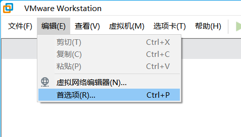

# VMware虚拟机操作

[TOC]

# 一、初始化配置

更改虚拟机文件存储路径



计算机容量单位

1. Bit（比特）：计算机最小的数据单位，只能表示0或1。
2. Byte（字节）：8个比特（bit）组成一个字节，可以表示一个字符。
3. Kilobyte（千字节）：1024个字节组成一个千字节，常用符号为KB。
4. Megabyte（兆字节）：1024个千字节组成一个兆字节，常用符号为MB。
5. Gigabyte（吉字节）：1024个兆字节组成一个吉字节，常用符号为GB。
6. Terabyte（太字节）：1024个吉字节组成一个太字节，常用符号为TB。
7. Petabyte（拍字节）：1024个太字节组成一个拍字节，常用符号为PB。
8. Exabyte（艾字节）：1024个拍字节组成一个艾字节，常用符号为EB。
9. Zettabyte（泽字节）：1024个艾字节组成一个泽字节，常用符号为ZB。
10. Yottabyte（尧字节）：1024个泽字节组成一个尧字节，常用符号为YB。

# 二、虚拟机文件介绍

| 文件类型 | 后缀名称             |
| -------- | -------------------- |
| 配置文件 | xxxx.vmx             |
| 日志文件 | xxx.log              |
| 磁盘文件 | xxx.vmdk             |
| 快照文件 | xxxxx-Snapshot1.vmsn |

# 三、虚拟机相关概念

- 宿主机：安装了虚拟机软件的主机
- 虚拟机：在虚拟机软件中安装了操作系统的独立硬件

# 四、虚拟机架构

- 寄居架构

  - 必须依托于操作系统

  - 产品：VMware Workstation

- 原生架构

  - 不依托操作系统，直接安装到硬件

  - 产品：VMware VSphere

# 五、虚拟机使用技巧

## 1、挂起

暂停虚拟机的当前运行状态

不受宿主机的开关机影响

## 2、快照

保存当前虚拟机运行状态

快照文件不稳定

## 3、克隆

### 3.1、链接克隆

基于原有虚拟机文件创建了快捷方式

一旦原有虚拟机文件损坏，链接克隆也不可使用

### 3.2、完整克隆

复制了一份新的虚拟机文件

独立于原有虚拟机文件，不受原虚拟机的影响

## 4、OVF模版

导出为OVF模版

# 六、虚拟机网络设置

## 1、网卡类型

1. 物理网卡：宿主机的网卡

2. 虚拟网卡：vmware虚拟机为了通信生成的网卡

   - 相对于宿主机，是虚拟网卡

   - 相对于虚拟机，就是该虚拟机的真实网卡

## 2、连接模式

### 2.1、桥接模式

共享宿主机的物理网卡

可当宿主机能访问互联网时，虚拟机也能访问

能实现不同宿主机之间的虚拟机通信

### 2.2、NAT模式

共享宿主机IP地址，使用不同的端口号通信

可当宿主机能访问互联网时，虚拟机也能访问

只能实现同一个宿主不同虚拟机之间的通信

只允许 一块虚拟网卡是NAT模式

### 2.3、仅主机模式

不能访问互联网（外部网络）

只能实现同一个宿主不同虚拟机之间的通信

### 2.4、测试主机之间的网络连通性

```bash
ping    IP地址
```

