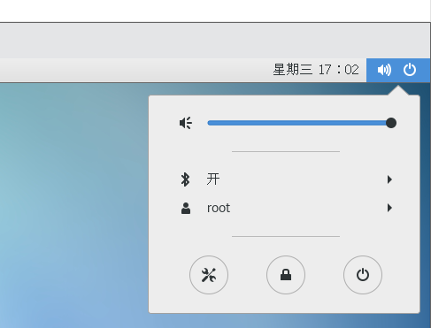

# Linux系统基础设置与命令行


[TOC]

# 一、系统基本操作

## 1、登录界面

- 一个普通用户
- 未列出，自由的输入用户名进行登录

## 2、桌面

- 主文件夹，家目录
- 回收站
- 光驱，加载镜像光盘，默认导入镜像文件后自动挂载

## 3、任务栏

- 应用程序，常用的工具
- 位置
  - 家目录
  - 光驱
  - 网络访问
- 时间和日期
- 关机按钮
  - 网络设置
  - 账户设置
  - 设置按钮
  - 锁屏按钮
  - 关机按钮

## 4、中文输入法设置

关机按钮->设置->language->输入源的+号->汉语(中国)->pinyin



## 5、设置终端打开快捷键

关机按钮->设置->设备->keyboard->下滑到底->+号

- 名称:terminal
- 命令:/usr/bin/gnome-terminal
- 快捷键:win+r

## 6、终端操作

### 6.1、登录显示

#### 普通用户

```bash
[zhx@localhost ~]$
[username@hostname homeDirectory（~）]$
```


#### 超级管理员用户root

```bash
[root@localhost ~]#
[username@hostname homeDirectory（~）]#
```


#### 目录切换后

```bash
[username@hostname 当前目录名称]#|$
```


### 6.2、快捷键

| 操作目标                   | 快捷键                         |
| -------------------------- | ------------------------------ |
| 复制                       | ctrl+shift +c                  |
| 鼠标操作                   | 选中要复制的内容，按压鼠标滚轮 |
| 粘贴                       | ctrl+shift +v                  |
| 剪切                       | ctrl+shift +x                  |
| 撤销                       | ctrl+z                         |
| 打断操作                   | ctrl + c                       |
| 放大                       | ctrl + shift + =               |
| 缩小                       | ctrl +                         |
| 清楚屏幕内容               | ctrl + l（小写L）或者clear命令 |
| 在同一终端下打开多个子标签 | ctrl + shift +t                |
| 在同一终端下切换多个子标签 | alt + 键盘横排数字             |
| 退出终端                   | exit                           |

### 6.3、个性化设置

- 背景

  - 编辑

  - 首选项

  - 颜色

- 字体
  - 编辑
  - 首选项
  - 文本

# 二、命令行基础

## 1、命令语法

```bash
命令字  [选项]  [参数1]  [参数2] ....
```

- 选项可以有多个
- 参数也可以有多个

## 2、命令类型

- 内部命令：集成于shell解释器之内的命令，运行速度更快，也称为内嵌命令
- 外部命令：集成于shell解释器之外的命令，能够完成特定功能的脚本文件或二进制程序文件

## 3、type命令

- 作用
  - 查看命令的类型

- 语法
  - type 需要查看的命令字

## 4、命令补齐

- 随便输入字母
- 按两次tab
- 输入到指定字母后没有其他命令则会补齐

## 5、命令帮助

### 5.1、help

查看指定的内部命令帮助信息

### 5.2、--help

查看指定的外部命令帮助信息

### 5.3、man

| 操作    | 作用                                                 |
| ------- | ---------------------------------------------------- |
| space   | 向下翻屏                                             |
| b       | 向上翻屏                                             |
| enter   | 向下翻行                                             |
| k       | 向上翻行                                             |
| G       | 跳转最后                                             |
| 1G\|gg  | 跳转第一行                                           |
| q       | 退出                                                 |
| /关键字 | 搜索<br>n:根据关键字向下查找<br>N:根据关键字向上查找 |

### 5.4、info

| 操作  | 作用               |
| ----- | ------------------ |
| tab   | 节点之间跳转       |
| enter | 进入某一个节点页面 |
| n     | 跳转下一个节点     |
| p     | 跳转上一个节点     |
| u     | 跳转上一级节点     |
| q     | 退出               |

# 三、系统基本操作命令

## 1、路径类型

- 绝对路径：每次都从/出发
- 相对路径：从当前位置出发

## 2、操作命令

```bash
#查看主机名
hostname
--n

#查看网卡参数，默认网卡名称：ens33
ifconfig #只查看已启用网卡
ip a #查看所有网卡，包括未启用的
#查看指定网卡参数
ifconfig  网卡名称

#查看CPU信息
cat /proc/cpuinfo
lscpu

#查看内存信息
cat /proc/meminfo
lsmem #查看物理内存
#查看内存的使用情况
free -m

#查看磁盘使用情况
df -Th
#关机命令
poweroff
shutdown now
init 0
#重启命令
reboot
shutdown -r
init 6
#切换目录
cd
#查看目录内容
dir
ls
#查看文件内容
cat
#打印所处目录的绝对路径
pwd
```


# 四、系统信息查看与修改

## 1、主机名管理

- 临时修改，重启失效

```bash
hostname  new_hostname
```

- 刷新

```bash
bash
```

- 永久修改

```bash
hostnamectl set-hostname  new_hostname
```

- 配置文件修改，重启生效

```bash
vim /etc/hostname
```

## 2、时间管理

### 2.1、系统时间管理

**date命令**

用于显示或设置系统的日期和时间。

**语法：**

```bash
date  [选项] [+格式]
```

**选项：**

| 选项                | 作用                                                         |
| ------------------- | ------------------------------------------------------------ |
| `d, date=STRING`    | 根据字符串计算并显示日期和时间。                             |
| `f, file=FILE`      | 从文件中读取日期和时间。                                     |
| `r, reference=FILE` | 根据文件的修改时间显示日期和时间。                           |
| `s, set=STRING`     | 设置日期和时间。                                             |
| `t, time=STRING`    | 根据时间字符串设置日期。                                     |
| `u, utc, universal` | 显示或设置UTC时间。                                          |
| `+FORMAT`           | 按照格式字符串输出日期和时间。                               |
| date -d @秒数       | 将秒数显示为时间格式，原点为计算机元年时间，即：1970年1月1日 8点 |

### 2.2、硬件时间管理 

**hwclock命令**

现在硬件bios中的时间

**时间同步**

```bash
hwclock -w
```

## 3、显示输出系统信息

### 3.1、uname命令

用于显示系统信息，包括操作系统名称、主机名、内核版本等。

**语法：**

```bash
uname [选项]
```

**选项：**

| 选项    | 作用                                                         |
| ------- | ------------------------------------------------------------ |
| `uname` | 显示系统内核名称。                                           |
| `-a`    | 显示所有系统信息，包括操作系统名称、内核版本、主机名、架构等。 |
| `-s`    | 显示操作系统名称。                                           |
| `-n`    | 显示主机名。                                                 |
| `-r`    | 显示内核版本号。                                             |
| `-m`    | 显示系统架构。                                               |
| `-p`    | 显示处理器类型。                                             |
| `-o`    | 显示操作系统发行商。                                         |
| `-i`    | 显示硬件平台信息。                                           |

### 3.2、显示系统版本

```bash
cat /etc/redhat-release
#RedHat系列特有
cat /etc/centos-release
#所有Linux系统都有
cat /etc/os-release
```


# 五、Linux系统常用的100条命令

| 命令         | 作用及案例                                                   |
| ------------ | ------------------------------------------------------------ |
| ls           | 列出当前目录中的文件和子目录。                               |
| pwd          | 显示当前工作目录的路径。                                     |
| cd           | 切换目录，例如：cd /path/to/directory。                      |
| touch        | 创建空文件，例如：touch filename.txt。                       |
| mkdir        | 创建新目录，例如：mkdir new_directory。                      |
| rmdir        | 删除空目录，例如：rmdir directory_name。                     |
| rm           | 删除文件或目录，例如：rm file.txt 或 rm -r directory。       |
| cp           | 复制文件或目录，例如：cp source_file destination 或 cp -r source_directory destination。 |
| mv           | 移动文件或目录，也可用于重命名文件，例如：mv source destination。 |
| cat          | 查看文件内容，例如：cat filename.txt。                       |
| less         | 逐页查看文件内容，例如：less filename.txt。                  |
| more         | 逐页查看文件内容，但不能向前翻页，只能向下滚动，例如：more filename.txt。 |
| head         | 显示文件的前几行，默认为前 10 行，例如：head filename.txt。  |
| tail         | 显示文件的最后几行，默认为最后 10 行，例如：tail filename.txt。 |
| grep         | 在文件中搜索文本，例如：grep “pattern” filename.txt。        |
| find         | 在文件系统中查找文件，例如：find /path/to/search -name “filename”。 |
| ps           | 显示当前进程的信息，例如：ps aux。                           |
| top          | 动态显示系统资源使用情况和进程信息。                         |
| kill         | 终止进程，例如：kill process_id。                            |
| shutdown     | 关闭或重启系统，例如：shutdown -h now（立即关机）或 shutdown -r now（立即重启）。 |
| ifconfig     | 显示网络接口的配置信息。                                     |
| ping         | 测试与远程主机的网络连接，例如：ping google.com。            |
| netstat      | 显示网络统计信息，例如：netstat -tuln。                      |
| yum          | CentOS 7 的包管理器，用于安装、更新和删除软件包。            |
| rpm          | 安装和管理 RPM 软件包，例如：rpm -i package.rpm。            |
| systemctl    | 管理系统服务，例如：systemctl start service_name 或 systemctl stop service_name。 |
| firewall-cmd | 管理防火墙规则，例如：firewall-cmd --zone=public --add-port=80/tcp --permanent。 |
| useradd      | 创建新用户，例如：useradd username。                         |
| passwd       | 更改用户密码，例如：passwd username。                        |
| userdel      | 删除用户，例如：userdel username。                           |
| groupadd     | 创建新用户组，例如：groupadd groupname。                     |
| usermod      | 修改用户属性，例如：usermod -aG groupname username。         |
| chown        | 更改文件或目录的所有者，例如：chown user:group file_or_directory。 |
| chmod        | 更改文件或目录的权限，例如：chmod 755 filename。             |
| df           | 显示磁盘空间使用情况。                                       |
| du           | 显示目录的磁盘使用情况，例如：du -sh directory_name。        |
| date         | 显示系统日期和时间。                                         |
| cal          | 显示日历，例如：cal 2023。                                   |
| tar          | 创建和解压 tar 归档文件，例如：tar -zxvf archive.tar.gz。    |
| zip/unzip    | 压缩和解压 ZIP 文件。                                        |
| ssh          | 使用 SSH 连接到远程主机，例如：ssh username@hostname。       |
| scp          | 通过 SSH 复制文件，例如：scp file.txt remote_username@remote_host:/remote/directory。 |
| wget         | 下载文件或内容，例如：wget URL。                             |
| curl         | 发送 HTTP 请求，例如：curl -I URL。                          |
| hostname     | 显示或设置主机名。                                           |
| history      | 显示命令历史记录。                                           |
| who          | 显示当前登录用户。                                           |
| shutdown     | 关闭或重启系统，例如：shutdown -h now（立即关机）或 shutdown -r now（立即重启）。 |
| reboot       | 重启系统，例如：reboot。                                     |
| exit         | 退出当前终端会话。                                           |
| grep         | 在文件中搜索文本，例如：grep “pattern” filename.txt。        |
| find         | 在文件系统中查找文件，例如：find /path/to/search -name “filename”。 |
| ps           | 显示当前进程的信息，例如：ps aux。                           |
| top          | 动态显示系统资源使用情况和进程信息。                         |
| kill         | 终止进程，例如：kill process_id。                            |
| shutdown     | 关闭或重启系统，例如：shutdown -h now（立即关机）或 shutdown -r now（立即重启）。 |
| ifconfig     | 显示网络接口的配置信息。                                     |
| ping         | 测试与远程主机的网络连接，例如：ping google.com。            |
| netstat      | 显示网络统计信息，例如：netstat -tuln。                      |
| yum          | CentOS 7 的包管理器，用于安装、更新和删除软件包。            |
| rpm          | 安装和管理 RPM 软件包，例如：rpm -i package.rpm。            |
| systemctl    | 管理系统服务，例如：systemctl start service_name 或 systemctl stop service_name。 |
| firewall-cmd | 管理防火墙规则，例如：firewall-cmd --zone=public --add-port=80/tcp --permanent。 |
| useradd      | 创建新用户，例如：useradd username。                         |
| passwd       | 更改用户密码，例如：passwd username。                        |
| userdel      | 删除用户，例如：userdel username。                           |
| groupadd     | 创建新用户组，例如：groupadd groupname。                     |
| usermod      | 修改用户属性，例如：usermod -aG groupname username。         |
| chown        | 更改文件或目录的所有者，例如：chown user:group file_or_directory。 |
| chmod        | 更改文件或目录的权限，例如：chmod 755 filename。             |
| df           | 显示磁盘空间使用情况。                                       |
| du           | 显示目录的磁盘使用情况，例如：du -sh directory_name。        |
| date         | 显示系统日期和时间。                                         |
| cal          | 显示日历，例如：cal 2023。                                   |
| tar          | 创建和解压 tar 归档文件，例如：tar -zxvf archive.tar.gz。    |
| zip/unzip    | 压缩和解压 ZIP 文件。                                        |
| ssh          | 使用 SSH 连接到远程主机，例如：ssh username@hostname。       |
| scp          | 通过 SSH 复制文件，例如：scp file.txt remote_username@remote_host:/remote/directory。 |
| wget         | 下载文件或内容，例如：wget URL。                             |
| curl         | 发送 HTTP 请求，例如：curl -I URL。                          |
| hostname     | 显示或设置主机名。                                           |
| history      | 显示命令历史记录。                                           |
| who          | 显示当前登录用户。                                           |
| shutdown     | 关闭或重启系统，例如：shutdown -h now（立即关机）或 shutdown -r now（立即重启）。 |
| reboot       | 重启系统，例如：reboot。                                     |
| exit         | 退出当前终端会话。                                           |
| sed          | 流编辑器，用于处理文本流，例如：sed ‘s/old_text/new_text/’ filename.txt。 |
| awk          | 文本处理工具，用于从文本文件中提取和处理数据。               |
| diff         | 比较文件和目录的差异，例如：diff file1.txt file2.txt。       |
| ln           | 创建链接（符号链接或硬链接），例如：ln -s source_file link_name。 |
| ssh-keygen   | 生成 SSH 密钥对。                                            |
| df           | 显示磁盘使用情况，例如：df -h（以人类可读的格式显示）。      |
| free         | 显示系统内存使用情况。                                       |
| uptime       | 显示系统的运行时间和平均负载。                               |
| whoami       | 显示当前登录用户的用户名。                                   |
| whatis       | 显示命令的简短描述，例如：whatis command。                   |
| man          | 查看命令的手册页，例如：man command。                        |
| df           | 显示文件系统的磁盘使用情况。                                 |
| ln           | 创建文件链接，例如：ln -s source_file link_name。            |
| ncdu         | 使用 ncurses 界面显示磁盘使用情况，需要额外安装。            |

