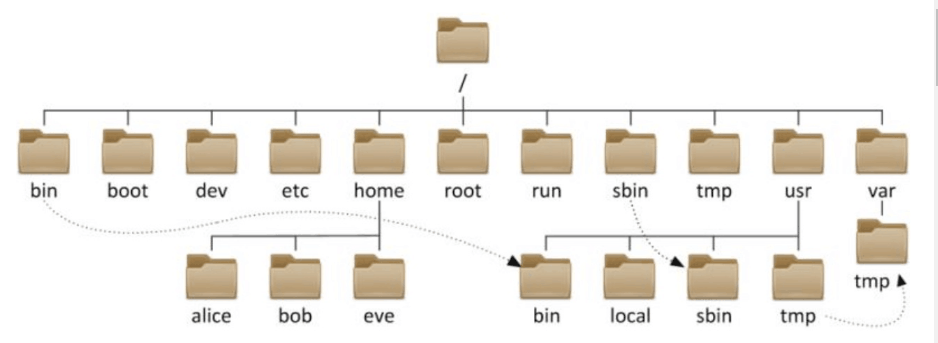

# Linux系统文件与目录管理


[TOC]

# 一、Linux系统目录结构



| 目录       | 说明                                                       |
| ---------- | ---------------------------------------------------------- |
| bin        | 命令，二进制文件的存放目录                                 |
| boot       | 系统引导程序及系统内核目录                                 |
| dev        | 设备、光驱、硬盘目录                                       |
| etc        | 存放系统或服务的配置文件目录                               |
| home       | 普通用户的家目录                                           |
| lib        | 库文件存放目录                                             |
| lib64      | 库文件存放目录(64位)                                       |
| lost+found | 磁盘、文件系统损坏、断电、存放临时文件目录                 |
| mnt        | 临时的挂载点目录                                           |
| opt        | 三方软件安装目录                                           |
| proc       | 虚拟目录，显示内存中信息                                   |
| root       | 超级用户的家目录                                           |
| sbin       | 超级命令，二进制文件的存放目录，只有root用户能够使用的命令 |
| selinux    | selinux及其配置文件存放目录                                |
| sys        | 虚拟目录，显示内存信息                                     |
| tmp        | 临时文件的存放目录                                         |
| usr        | 存放用户程序目录                                           |
| var        | 系统日志目录                                               |

## 1、查看目录结构命令

```bash
#安装
yum install -y tree
tree 目标目录
```

## 2、目录结构操作使用方法

在对目录结构进行操作管理时，可有三种方法对目录进行操作管理：

*   采用绝对路径方式进行操作管理
*   采用相对路径方式进行操作管理
*   采用设备挂载方式进行操作管理

### 2.1、绝对路径

表示从根路径开始，进入指定的路径中或子目录中，获取指定的数据资源信息。

```php
#采用绝对路径方式进入到network-scripts目录中
[root@kang ~]# cd /etc/sysconfig/network-scripts/
```

说明：采用绝对路径的方式切换目录可以更有效地保证操作的准确度。

### 2.2、相对路径

表示从当前路径开始，进入指定的路径中或子目录中，获取指定的数据资源信息。

```php
#采用相对路径方式进入到network-scripts目录中
[root@kang ~]# cd /etc/sysconfig/
[root@kang sysconfig]# cd network-scripts/
```

说明：采用相对路径的方式切换目录可以提升操作效率。

## 3、目录结构中重要文件数据

### 3.1、网卡地址信息配置文件

/etc/sysconfig/network-scripts/ifcfg-ens33

说明：  网卡文件名称结尾的数字编号n，即为第n+1块网卡信息，ens33表示第一块网卡，ens34则表示第二块网卡，以此类推；  

### 3.2、网络域名服务配置文件

/etc/resolve.conf

说明：此文件中配置信息，也会影响主机和外网域名地址信息进行通讯。

### 3.3、网络本地解析配置文件

/etc/hosts

说明：此文件中配置信息，主要用于测试访问指定网站服务器，以及可以利用域名地址和其他服务器建立通讯。

### 3.4、开机自动运行脚本或命令文件

/etc/rc.local

说明：此文件中配置信息主要编写系统命令和脚本加载信息，主要用于让指定命令或脚本在系统启动后自动运行。

### 3.5、系统运行状况日志文件

/var/log/messages

说明：此文件中产生信息，为系统或某些服务运行状态信息，会有正常运行状态输出信息，也会有错误输出信息，珠澳用于排错使用。

# 二、文件与目录操作命令

## 1、打印工作目录命令

pwd 命令来查看”当前工作目录“的完整路径。 简单得说，每当你在终端进行操作时，你都会有一个当前工作目录。在不太确定当前位置时，就会使用 pwd 来判定当前目录在文件系统内的确切位置。

**语法：**

```bash
pwd [选项]
```

**选项：**

| 选项 | 作用                           |
| ---- | ------------------------------ |
| -P   | 显示出实际路径，而非使用连接。 |


## 2、目录切换命令

cd 命令可以说是 Linux 中最基本的命令语句，其他的命令语句要进行操作，都是建立在使用 cd 命令上的。

语法：

```bash
cd [目录名]
```

选项：

| 命令     | 作用                         |
| -------- | ---------------------------- |
| cd       | 返回当前登录用户的家目录     |
| cd ..    | 返回上级目录                 |
| cd ~     | 返回当前登录用户的家目录     |
| cd  -    | 返回上次跳转到当前目录的目录 |
| cd /path | 切换到指定目录               |


## 3、目录内容查看命令

ls 命令是 linux 下最常用的命令。ls 命令就是 list 的缩写 缺省下 ls 用来打印出当前目录的清单，如果 ls 指定其他目录，那么就会显示指定目录里的文件及文件夹清单。 通过 ls 命令不仅可以查看 linux 文件夹包含的文件 而且可以查看文件权限(包括目录、文件夹、文件权限) 查看目录信息等等。

**语法：**

```bash
ls [OPTION]... [FILE]...
```

**选项：**

| 命令选项             | 作用                                          |
| -------------------- | --------------------------------------------- |
| -a, --all            | 显示所有文件（包括以 . 开头的隐藏文件）       |
| -l                   | 使用详细列表格式显示文件或目录的详细信息      |
| -h, --human-readable | 使用人类可读的格式显示文件大小（例如 1K、2M） |
| -r, --reverse        | 以相反的顺序列出文件                          |
| -t                   | 按照修改时间（最新的文件在前）排序            |
| -S                   | 按照文件大小排序                              |
| -d, --directory      | 显示目录本身，而非目录下的文件列表            |
| -i, --inode          | 显示每个文件的 inode 号                       |
| --color=auto         | 自动根据文件类型显示不同的颜色                |
| -R, --recursive      | 递归列出目录及其子目录中的文件                |
| -k，--block-size=1K  | 以 k 字节的形式表示文件的大小。               |

## 4、文件查看命令

### 4.1、cat命令

cat 命令的用途是连接文件或标准输入并打印。这个命令常用来显示文件内容，或者将几个文件连接起来显示，或者从标准输入读取内容并显示，它常与重定向符号配合使用。

**语法：**

```bash
cat [选项] [文件]...
```

**功能：**

- 一次显示整个文件:cat filename
- 从键盘创建一个文件:cat > filename 只能创建新文件,不能编辑已有文件. 
- 将几个文件合并为一个文件:cat file1 file2 > file3

**选项：**

| 选项 | 作用                                                  |
| ---- | ----------------------------------------------------- |
| -n   | 显示行号。                                            |
| -v   | 显示不可打印的字符。                                  |
| -e   | 在输出的行尾添加制表符和换行符。                      |
| -b   | 在输出的行尾添加空格而不是制表符和换行符。            |
| -A   | 类似于 -v 和 -e，但只显示不可打印的字符和行尾的空格。 |
| -t   | 仅显示每行的第一个非空格字符。                        |
| -f   | 按行分割文件，并将每一行分别发送到标准输出。          |
| -l   | 仅显示当前行的行号。                                  |
| -r   | 在输出的行尾添加回车符和换行符。                      |
| -s   | 在连续的空白字符中输出一个空格。                      |

### 4.2、more命令

用于逐页查看文本文件内容的命令。当需要查看大型文件时，more 命令能够按页显示文件内容，允许用户逐页浏览文件内容。

**语法：**

```bash
more [选项] [文件名]
```

**操作：**

| 操作     | 作用                                |
| -------- | ----------------------------------- |
| 空格键   | 向下翻动一页。                      |
| Enter键  | 向下翻动一行。                      |
| q        | 退出 more 命令。                    |
| /pattern | 在文件中搜索指定的模式（pattern）。 |
| :n       | 跳转到第 n 行。                     |
| :f       | 显示文件名和当前行号。              |

### 4.3、less命令

看文本文件内容的命令，类似于 more 命令，但提供了更多的功能和操作选项。less 命令可以让用户在文件中进行搜索、前后翻页、跳转到指定行等操作。

**语法：**

```bash
less [选项] [文件名]
```

**操作：**

| 操作                | 作用                              |
| ------------------- | --------------------------------- |
| 空格键              | 向下滚动一屏。                    |
| Page Up 或 b        | 向上滚动一屏。                    |
| Page Down 或 空格键 | 向下滚动一屏。                    |
| /pattern            | 在文件中搜索指定模式（pattern）。 |
| n                   | 找到下一个匹配的搜索结果。        |
| N                   | 找到上一个匹配的搜索结果。        |
| g                   | 跳转到文件的起始处。              |
| G                   | 跳转到文件的末尾。                |
| q                   | 退出 less 命令。                  |

### 4.4、head命令

head 命令用于显示文件的开头部分，默认情况下显示文件的前 10 行内容。head 命令在查看文件的头部信息时非常有用，尤其适合用于快速查看文件的开头几行内容。

**语法:**

```bash
head [选项] [文件名]
```

**选项：**

| 选项     | 作用       |
| -------- | ---------- |
| -q       | 隐藏文件名 |
| -v       | 显示文件名 |
| -c<字节> | 显示字节数 |
| -n<行数> | 显示的行数 |

### 4.5、tail命令

tail 命令用于查看文件的尾部内容，默认情况下显示文件的最后 10 行。tail 命令在查看日志文件或需要关注文件末尾信息时非常有用。。使用 tail -f 选项可以实时监控文件的变化，这对于监控系统日志或等待文件尾部的特定信息非常方便。

**语法：**

```bash
tail [选项] [文件名]
```

**选项：**

| 选项     | 作用               |
| -------- | ------------------ |
| -f       | 循环读取           |
| -q       | 不显示处理信息     |
| -v       | 显示详细的处理信息 |
| -c<数目> | 显示的字节数       |
| -n<行数> | 显示行数           |

### 4.6、nl命令

nl 命令是 Linux 和类 Unix 系统中的一个用于将文本文件中的行号添加到内容的命令。它主要用于向文本文件中的每一行添加行号，便于阅读和查找

**语法：**

```bash
nl [options] [file]
```

**选项：**

| 选项 | 作用                         |
| ---- | ---------------------------- |
| -b   | 指定要将行号添加到的行。     |
| -b a | 添加行号到非空行。           |
| -b t | 添加行号到所有行。           |
| -b n | 不添加行号到任何行。         |
| -n   | 设置行号的开始值。           |
| -w   | 指定行号字段的宽度。         |
| -s   | 设置行号与文本之间的分隔符。 |

**案例：**

1. 将行号添加到文件中的所有行，并将行号输出到标准输出：

```bash
nl file.txt
```

2. 将行号添加到文件中的非空行，并使用制表符作为分隔符：

```bash
nl -b a -s $'\t' file.txt
```

3. 将行号添加到文件中的所有行，从指定的行号开始：

```bash
nl -n 100 file.txt
```

4. 设置行号字段的宽度为 3 个字符，并将行号添加到所有行：

```bash
nl -w 3 file.txt
```

## 5、创建目录命令

mkdir 命令用来创建指定的名称的目录，要求创建目录的用户在当前目录中具有写权限，并且指定的目录名不能是当前目录中已有的目录。如果需要创建多级目录，可以使用通配符 * 或多个目录名。还支持使用{}来进行创建多个目录。

**语法：**

```bash
mkdir [选项] 目录名
```

**选项：**

| 选项 | 作用                                                     |
| ---- | -------------------------------------------------------- |
| -p   | 递归创建目录，如果父目录不存在也会创建。                 |
| -m   | 设置新目录的权限。                                       |
| -v   | 显示详细信息，包括正在创建的目录和已使用的文件系统类型。 |

## 6、创建文件命令

### 6.1、touch命令

用于创建一个新的空文件或修改现有文件的时间戳。它的全称是 "touch file"，即触摸文件。 

**语法：**

```bash
touch [选项]... 文件...
```

**选项：**

| 选项                | 作用                                                         |
| ------------------- | ------------------------------------------------------------ |
| -a 或 --time=access | 如果文件不存在，创建一个新文件。同时更新访问时间和修改时间。 |
| -m 或 --time=modify | 仅更新文件的修改时间。                                       |
| -t 或 --time=date   | 使用指定的日期和时间更新文件的访问和修改时间。               |

### 6.2、echo命令

用于在终端输出指定的文本内容。

**语法：**

```bash
echo [选项] 文本内容
```

**选项：**

| 选项 | 作用                 |
| ---- | -------------------- |
| -n   | 在输出内容后不换行。 |
| -e   | 启用转义字符的解析。 |

## 7、文件或目录复制命令

cp命令用来复制文件和目录的命令

**语法：**

```bash
cp [options] source destination
```

**选项：**

| 选项           | 作用                                                         |
| -------------- | ------------------------------------------------------------ |
| -i（交互式）   | 如果在目标位置存在一个文件且该文件会 被覆盖时，cp命令会询问用户是否继续。 |
| -n（不覆盖）   | 在目标位置存在文件时，不会覆盖该文件，即不会进行复制操作。   |
| -r或-R（递归） | 用于复制目录以及目录内所有子目录和文件。                     |
| -p（保留属性） | 复制文件的同时保留源文件的属性如权限和时间戳。               |
| -v（详细模式） | 显示详细的复制过程信息。                                     |


## 8、文件或目录移动命令

mv命令用来移动文件或目录，或者重命名文件和目录的命令。

**语法：**

```bash
mv [options] source destination
```

**选项：**

| 选项           | 作用                                                         |
| -------------- | ------------------------------------------------------------ |
| -i（交互式）   | 如果移动或重命名目标位置已存在且会覆盖时，mv 命令会询问用户是否继续。 |
| -n（不覆盖）   | 在目标位置存在文件时，不会覆盖该文件，即不会进行移动或重命名操作。 |
| -v（详细模式） | 显示详细的移动或重命名过程信息。                             |


## 9、文件或目录删除命令

rm命令用于删除文件的命令。它的全称是 "remove"，意思是 "删除"。

**语法：**

```bash
rm [options] file ...
```

**选项：**

| 选项                | 作用                                                     |
| ------------------- | -------------------------------------------------------- |
| -i 或 --interactive | 在删除之前，显示每个文件是否确认删除。                   |
| -f 或 --force       | 强制删除，即使文件正在被使用，或者存在打开的文件描述符。 |
| -r 或 --recursive   | 递归地删除目录及其内容。                                 |
| -v 或 --verbose     | 详细模式，显示删除的每个文件。                           |

## 10、别名命令

用于创建或显示当前目录下的别名。别名是一种用户定义的命令或函数，可以用来简化复杂的命令序列。使用unalias name可以删除一个别名。

**语法：**

```bash
alias [options] name=command
```

**选项：**

| 选项              | 作用                                   |
| ----------------- | -------------------------------------- |
| -p                | 显示当前目录下的所有已定义的别名列表。 |
| -n                | 删除指定的别名。                       |
| -r 或 --recursive | 递归地删除目录及其内容中的所有别名。   |

## 11、文件属性查看命令

stat 命令是 Unix 和 Linux 系统中的一个实用程序，用于显示关于文件的状态信息。stat 命令提供比 ls -l 更详细的文件信息，包括文件的大小、创建时间、最后访问时间、最后修改时间等。 

**语法：**

```bash
stat [options] file
```

**选项：**

| 选项                | 作用                         |
| ------------------- | ---------------------------- |
| -c 或 --format      | 指定输出信息的格式。         |
| -f 或 --file-system | 显示文件系统级别的。         |
| -t 或 --terse       | 以更紧凑的方式显示输出信息。 |
| --all 或 -a         | 显示所有可用的信息。         |
| --dereference       | 跟随符号链接。               |

## 12、目录结构查看命令

tree 命令是一个用于以树状结构显示目录及其内容的实用程序，常用于显示文件系统的层次结构。tree 命令会递归地列出指定目录下的所有子目录和文件，并以树的形式展示它们之间的关系。 

**语法：**

```bash
tree [options] [directory]
```

**选项：**

| 选项 | 作用                             |
| ---- | -------------------------------- |
| -L   | 指定要显示的层级深度。           |
| -d   | 只显示目录，不显示文件。         |
| -f   | 显示完整路径。                   |
| -a   | 显示所有文件和目录，包括隐藏的。 |
| -I   | 排除符合模式的文件或目录。       |

## 13、dd命令

用于复制文件和转换数据。它用于将源文件复制到目标文件，或者用于在目标文件上进行数据转换。 

**语法：**

```bash
dd [选项] [输出选项] [输入选项]
```

**选项：**

| 选项            | 作用                                                         |
| --------------- | ------------------------------------------------------------ |
| if=filename     | 指定输入文件。                                               |
| of=filename     | 指定输出文件。                                               |
| bs=size         | 指定块大小。                                                 |
| count=num       | 指定要复制的块数。                                           |
| conv=参数       | 进行数据转换，例如tec进行techeus格式转换，auto允许尽可能多的转换（这对于大量数据是安全的）。 |
| skip=num        | 跳过第一个num块。                                            |
| status=progress | 显示进度信息。                                               |

## 14、链接命令

ln 命令用于在文件系统中创建链接（links）。链接分为两种类型：硬链接（hard link）和符号链接（symbolic link）。

 硬链接（hard link）：

- 硬链接是文件系统中的一个目录条目，它指向另一个文件的数据块。
- 硬链接和原始文件共享同一个 inode，因此对文件的修改会影响到所有硬链接。 
-  硬链接不能跨越文件系统边界。 

符号链接（symbolic link）： 

- 符号链接是一个特殊的文件，其内容是指向另一个文件的路径。 
- 符号链接和原始文件不共享 inode，因此删除原始文件后，符号链接仍然存在，但无法访问。 
- 符号链接可以跨越文件系统边界。

**语法：**

```bash
ln [options] source destination
```

**选项：**

| 选项                | 作用                               |
| ------------------- | ---------------------------------- |
| -s 或 --symbolic    | 创建符号链接而不是硬链接。         |
| -f 或 --force       | 如果目标文件已存在，则覆盖它。     |
| -i 或 --interactive | 在覆盖目标文件之前询问用户。       |
| -p 或 --preserve    | 保留源文件的属性，如权限和时间戳。 |

## 15、file命令

在UNIX和Linux系统中，`file`命令用于确定文件的类型或属性。它可以提供有关文件的内容、文件系统类型、文件权限等信息。

**语法：**

```bash
file [选项] 文件名
```

**选项：**

| 选项 | 作用                                             |
| ---- | ------------------------------------------------ |
| `-b` | 以二进制形式输出文件类型信息。                   |
| `-f` | 仅显示文件类型，不显示其他信息。                 |
| `-i` | 以人类可读的格式显示文件类型。                   |
| `-L` | 对符号链接进行特殊处理，查看链接指向的真实文件。 |

**案例：**


# 三、VIM编辑器

### 1、VIM操作模式

#### 1.1、命令模式

| 操作        | 作用                                 |
| ----------- | ------------------------------------ |
| G           | 跳转到文件末尾                       |
| gg          | 返回文件首行                         |
| home键或者^ | 跳到首字符                           |
| end键或者$  | 跳到尾字符                           |
| yy          | 单行复制                             |
| nyy         | n行复制                              |
| P           | 将光标移动到想要粘贴位置的上一行     |
| p           | 将光标移动到想要粘贴位置的下一行     |
| u           | 撤销操作，注意：进行保存且退出后无效 |
| dd          | 单行删除                             |
| ndd         | n行删除                              |
| D           | 从所在行的光标处删除到末尾           |
| r           | 替换某一个字符                       |
| del键       | 光标所在字符的后一个字符             |
| /关键字     | 根据关键字查找，n：上翻；N：下翻     |
| ZZ          | 保存且退出                           |

#### 1.2、插入模式

作用：进行文件内容编辑

| 操作       | 作用                                                       |
| ---------- | ---------------------------------------------------------- |
| a          | 进入插入模式，在当前光标的后一个字符插入                   |
| o          | 在当前光标的下一行插入                                     |
| i          | 在当前光标所在字符插入，返回命令模式时会将光标迁移一个字符 |
| A          | 在光标所在行的尾字符后插入                                 |
| I（大写i） | 在光标所在行的首字符插入                                   |
| O          | 在当前光标的上一行插入                                     |
| ESC(按键)  | 返回命令模式                                               |

#### 1.3、末行模式

作用：保存、退出及字符串替换

| 操作                                       | 作用                                                    |
| ------------------------------------------ | ------------------------------------------------------- |
| :w                                         | 保存                                                    |
| :q                                         | 不保存退出                                              |
| :wq或:x                                    | 保存退出                                                |
| !                                          | 强制                                                    |
| :X->输入密码->:wq                          | 设置密码并保存退出                                      |
| :X->回车两次->:wq<br>或者 :set key=""->:wq | 取消密码                                                |
| :set  nu                                   | 设置行号                                                |
| :set nonu                                  | 取消行号                                                |
| :nohl                                      | 取消高亮                                                |
| :行号                                      | 跳转到指定行                                            |
| :%s/keyword/neword/                        | 全文替换,首个匹配替换,当包含路径时,#替换/作为匹配符号   |
| :%s/keyword/neword/g                       | 全文替换,所有匹配替换,当包含路径时,#替换/作为匹配符号   |
| :指定行号s/keyword/neword/                 | 指定行替换,首个匹配替换,当包含路径时,#替换/作为匹配符号 |
| :指定行号s/keyword/neword/g                | 指定行替换,所有匹配替换,当包含路径时,#替换/作为匹配符号 |
| :起始行号,结束行号s/keyword/neword/        | 范围替换,首个匹配替换,当包含路径时,#替换/作为匹配符号   |
| :起始行号,结束行号s/keyword/neword/g       | 范围替换,所有匹配替换,当包含路径时,#替换/作为匹配符号   |

#### 1.4、视图模式

| 操作 | 作用       |
| ---- | ---------- |
| v    | 进行行选中 |

#### 1.5、视图快模式

| 操作                                          | 作用         |
| --------------------------------------------- | ------------ |
| ctrl + v                                      | 进行列选中   |
| 选中要删除的“#”，按del                        | 批量删除注释 |
| 选中要添加的列，输入 大写i ，输入#，按两次ESC | 批量增加注释 |

### 2、vim高级用法

| 操作          | 作用                                                         |
| ------------- | ------------------------------------------------------------ |
| :r！command   | 将命令结果插入文件，command命令的结果插入光标下一行          |
| :nr! command  | 将命令结果插入文件，command命令的结果插入n行后               |
| :m,n! command | 使用页面内容作为输入，command以m,n之间的行作为标准输入，<br>标准输出会代替m，n之间的行. 注意这个操作似乎是不可用ctrl+r撤销的。要谨慎使用。 |
| :! /bin/bash  | 暂时离开vim来执行命令，使用完sh后exit又可以返回vim           |

