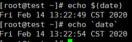
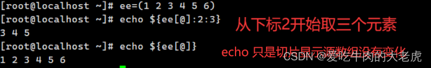
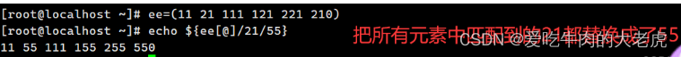

---
tags:
  - Linux基础教程
---

#  Linux中的特殊符号的作用

[TOC]

### 一、常见符号

#### 1.1 $? $# $\* $n $0 $@

1.  `$?`上一个命令的退出状态(若为`0`：表示成功；不是`0`，表示失败)，或者上一个函数的返回值，但是有两个注意点：函数一结束就取返回值；退出状态码必须是`0~255`，否则就使用`命令替换`获取返回值或者定义一个变量（`shell`的文件级和函数中定义的变量默认都是全局变量）
2.  `$#`表示脚本中参数的`个数`
3.  `$*`表示获取所有对应参数的值
4.  `$n`表示为（`n>=1`）的参数
5.  `$0`表示脚本名
6.  `$@`表示获取所有对应参数的值
7.  `$$` 表示`Shell`本身的`PID`（`ProcessID`）

`$*`和`$@`区别：`$*`变量会将所有参数当成单个参数，而`$@`变量会单独处理每个参数

```shell
###这是测试脚本
#!/bin/sh
echo 这是脚本名字：$0
echo 总共有$#个人，分别是$*
echo 第一个人是$1，第二个人是$2
### 这是运行结果
这是脚本名字：sympol.sh
总共有2个人，分别是李四 张三
第一个人是李四，第二个人是张三
```


#### 1.2 分号

在脚本中，`分号`是多个语句之间的`分隔符号`，当只有一个语句的时候，`末尾无需分号`，最后一个语句后面也`无需分号`，否则报错  

在交互式命令中，用分号隔开每个命令, 每个命令按照从左到右的顺序,顺序执行， 彼此之间不关心是否失败， 所有命令都会执行，例如：`command1 ; command2`  

另外，在交互式命令中可以使用小括号包括起来：`(command1 ; command2)`这样就会建一个子`shell`，是多进程建造方法，也可以使用大括号，但是末尾需要加分号：`{command1 ; command2 ; }`，但是这样创建的子shell会明显拖慢处理速度，在交互式的`CLI shell`会话中，`子shell`同样存在问题。它并非真正的多进程处理，因为终端控制着子shell的I/O

#### 1.3 引号

**`单引号`** 中是原始字符串，**`属于强引用`**，它会忽略所有被引起来的字符的特殊处理，被引用起来的字符会被原封不动的使用，唯一需要注意的点是不允许引用自身

**`双引号`** 可以对特殊字符进行扩展， **`属于弱引用`**，它会对一些被引起来的字符进行特殊处理。双引号与单引号的区别在于其可以包含特殊字符（单引号直接输出内部字符串，不解析特殊字符；双引号内则会解析特殊字符），包括`', ", $, \,`如果要忽略特殊字符，就可以利用`\`来转义，忽略特殊字符，作为普通字符输出

一般不写的就是当`双引号`用的

```shell
a=bcdef
echo $a # 输出bcdef
echo "$a" #双引号将进行变量扩展 ，输出bcdef
echo '$a' #单引号直接输出$a
```

#### 1.4 括号的作用

##### 1.4.1 命令替换

`shell`脚本中最有用的特性之一就是可以从命令输出中提取信息，并将其赋给变量。把输出赋给变量之后，就可以随意在脚本中使用了 
两种方式：

*   反引号字符（\`）
*   $()格式

`$( )` 和反引号`` ` `` (`tab`按键上面) 作用相同:命令替换  

  

命令替换还有一个作用就是可以用来获取函数返回值，可以避开使用`$?`的`0~255`限制

##### 1.4.2 命令列表和命令序列

在 `Linux` 中，`命令列表`使用小括号 `()`，而`命令序列`使用大括号 `{}`。这两种括号的使用有一些区别：

*   命令列表（`Command List`）使用小括号 `()`：
    *   命令列表中的命令会在一个`子shell`中执行，这意味着它们在一个新的进程环境中运行。
    *   命令列表中的`变量和环境设置`不会影响当前 `shell` 环境。
    *   命令列表中的变量和环境设置不会传递给后续命令。
    *   命令列表中的命令`按照顺序依次执行`，无论前面的命令是否成功。  
    *   例如：(command1; command2; command3)。
*   命令序列（`Command Sequence`）使用大括号 `{}`：
    *   命令序列中的命令在当前 `shell` 环境下执行，不会创建一个新的子`shell`
    *   命令序列中的`变量和环境设置`会影响当前 `shell` 环境。
    *   命令序列中的变量和环境设置会传递给后续命令。
    *   命令序列中的命令按照顺序依次执行，无论前面的命令是否成功。  
    *   例如：{ command1; command2; command3; }。

需要注意的是，在命令列表和命令序列中，命令之间的分隔符可以是`分号 ; 或换行符`。使用分号时，多个命令可以写在一行上；使用换行符时，每个命令占一行

##### 1.4.3 数组操作

###### 1.4.3.1 定义

数组是存放相同类型数据的集合，在内存中开辟了连续的空间，通常配合循环使用  

  

数组之间每个元素之间以空格间隔或制表符间隔，下标是从0开始从左往右依次增加

###### 1.4.3.2 初始化数组

定义数组的方式：

`数组名=(1 2 3 4 5)`

`数组名=([0]=1 [1]=2 [2]=3 [3]=4 [4]=5)`

- `列表名="1 2 3 4 5"`  
- `数组名=（$列表名）`

数值类型的数组：一对小括号`()`表示数组，数组中元素之间使用`空格`来隔开，`arr=(1 2 3 4 5)`  
字符串类型数组：同样，使用一对括号表示数组，其中数组中的元素使用`双引号`或者`单引号`包含，同样使用`空格`来隔开`arr=('a' 'b' 'c')`

###### 1.4.3.3 输出数组

`echo ${数组名[*]}`：`*或@`都是显示全部数组，`@或是*`，它扩展为数组的所有成员。这两种下标只有在双引号中才不同。在双引号中，`${name[*]}`扩展为一个词，由所有数组成员的值组成，`${arr[@]}`将数组的每个成员扩展为一个词。 如果数组没有成员，`${arr[@]}` 扩展为空串  
`echo ${数组名[下标]}`：可以指定输出这一下标所对应的元素  
`echo ${#数组名[*]}`或者 `echo ${#数组名[@]}`：可以查看数组的元素个数  
`echo ${!数组名[*]}`或者 `echo ${!数组名[@]}`：可以查看数组所有元素下标，即：键名

数组的任何元素都可以用`${arr[下标]}`来引用，`花括号`是必须的，以避免和路径扩展冲突。

###### 1.4.3.4 数组的操作

删除与添加：

*   `unset 数组名[下标]` ：删除数组的某个元素
*   `unset 数组名`：删除数组
*   `数组名[下标]`\=需要追加的值
*   `数组名[数组长度]`\=需要追加的值
*   数组名+=（“值1” “值2”）
*   `数组名=（“${数组名[@]}” “值1” “值2”）`

数组切片与替换：

- `${数组名[@]:下标:长度}` ##数组切片，获取从数组的某个下标开始的多少个元素  

如果想要实现数组的切片可以使用 `数组名=（${数组名[@]：下标：长度} ）`  



`${数组名[@]/旧字符/新字符}`  

用`echo`输出的结果不会影响源数组，想替换原数组需要 `数组名=(${数组名[@]/旧字符/新字符})` 



##### 1.4.4 数值运算

*   `$(( ))` 是整数数值运算，也可用`(( ))` 代替
*   另`$[ ]`也是进行数学运算的，在将一个数学运算结果赋给某个变量时，可以用美元符和方括号（`$[ operation ]`）将数学表达式围起来
*   `乘号(*)`前边必须加反斜杠(`\`)才能实现`乘法运算`

##### 1.4.5 test运算

`[ ]`是代替`test`运算符的，方括号定义了测试条件。注意，`第一个方括号之后和第二个方括号之前必须加上一个空格`，否则就会报错。  

test命令可以判断三类条件：

*   数值比较
*   字符串比较
*   文件比较

`(( ))` ：双括号命令允许你在比较过程中使用高级数学表达式。 `test`命令只能在比较中使用简单的算术操作  

`[[ ]]`：双方括号命令提供了针对字符串比较的高级特性

##### 1.4.6 ${}

###### 1.4.6.1 界定符号

`${}` 界定符号，比如`$ab`，就相当于`${ab}`，而`${a}b`才是只取`a`的值  

###### 1.4.6.2 取路径,文件名,后缀

```shell
#假设一个变量名为file
file=/dir1/dir2/dir3/my.file.txt
${file#*/}：删掉第一个 / 及其左边的字符串：dir1/dir2/dir3/my.file.txt
${file##*/}：删掉最后一个 / 及其左边的字符串：my.file.txt
${file#*.}：删掉第一个 . 及其左边的字符串：file.txt
${file##*.}：删掉最后一个 . 及其左边的字符串：txt
${file%/*}：删掉最后一个 / 及其右边的字符串：/dir1/dir2/dir3
${file%%/*}：删掉第一个 / 及其右边的字符串：(空值)
${file%.*}：删掉最后一个 . 及其右边的字符串：/dir1/dir2/dir3/my.file
${file%%.*}：删掉第一个 . 及其右边的字符串：/dir1/dir2/dir3/my
```

**记忆的方法为：**

*   `#` 表示从左边算起第一个（键盘上`#`在 `$` 的左边，要注意使用`#`时，删除符号`*`放在标志符号(`/或.`)左边）
*   `##`：表示从左边算起最后一个
*   `%`表示从右边算起第一个（键盘上`%` 在`$` 的右边，要注意使用`%`时，删除符号`*`放在标志符号(`/或.`)右边）
*   `%%`：表示从右边算起最后一个
*   `单一`符号是`最小匹配`；`两个`符号是`最大匹配`
*   `*`：表示要删除的内容，对于`#`和`##`的情况，它`位于`指定的字符（例子中的`'/'和'.'`）的`左边`，表示删除指定字符及其左边的内容；对于`%`和`%%`的情况，它`位于`指定的字符（例子中的`'/'和'.'`）的`右边`，表示删除指定字符及其右边的内容。这里的`*`的位置不能互换，即不能把`*`号放在`#`或`##`的右边，反之亦然。

##### 1.4.7 大括号扩展-批量操作

`Bash`大括号扩展，大括号包围的，用逗号隔开的参数会扩展为独立的多个参数，例如：`touch a{1,3}.txt` //只能创建`a1.txt`和`a3.txt`文件  
使用两个点号`..`可以按顺序或规律执行，例如`touch a{1..3}.txt` //创建是`a1.txt，a2.txt，a3.txt`

###### 1.4.7.1 批量创建文件

`touch file`:平时我们都是这样创建一个文件。  

如果我们想创建的文件，它的名字都类似:`file0.txt,file1.txt … … file9.txt`，那我们可不可以用一个命令直接快速创建多个文件？  

`touch file{0..9}.txt`:这条命令便可以实现上面的要求

###### 1.4.7.2 批量删除文件

`rm -rf file`:删除一个文件。  

如果我们想把上面批量创建的那些文件全部删除 该如何做呢？  

`rm -rf file{0..9}`

###### 1.4.7.3 批量创建文件夹

`mkdir dir`:创建一个文件夹。  

如果我们想快速创建名字类似的文件夹该如何做呢? 同理，  

`mkdir mkdir{0..9}`:这条命令便可以实现上面的要求。

###### 1.4.7.4 批量删除文件夹

`rmdir dir`: 只可以删除一个空文件夹。  

`rm -rf dir`:可以删除一个空、非空文件夹。  

如果批量删除上面的生成的文件夹。同理，  

`rmdir dir{0..9}` 或者`rm -rf dir{0..9}`

#### 1.5 与(&)或(|)

##### 1.5.1 与&

*   `&`：表示任务在后台执行，在后台运行，`redis-server &`
*   `&&`：表示前一条命令执行成功时，才执行后一条命令，如：`echo '1' && echo '2'`
*   与`>`连用时，如：`&>`，命令生成的所有输出都会发送到同一位置，包括数据和错误或者使用`exec`命令告诉`shell`在脚本执行期间重定向某个特定文件描述符，例如：`exec 1>testout`

##### 1.5.2 或|

*   `|` ：表示管道符，`上一条命令的输出`作为`下一条命令参数`
*   `||`：表示上一条命令执行`失败`后，才执行下一条命令，如：`cat nofile || echo '1'`

二、脚本符号
------

#### 2.1重定向输入输出

##### 2.1.1 文件描述符理解

| 文件描述符 | 缩 写 | 描 述 |
| --- | --- | --- |
| 0 | STDIN | 标准输入 |
| 1 | STDOUT | 标准输出 |
| 2 | STDERR | 标准错误 |

`注意`：在 **`重定向到`** 文件描述符时，必须在文件描述符数字之前加一个`&`，一般写法是`2 >&1`，把错误重定向到标准输出

```shell
echo "This is an error message" >&2
```

这行会在脚本的`STDERR`文件描述符所指向的位置显示文本，而不是通常的`STDOUT`

##### 2.1.2 重定向符号理解

###### 2.1.2.1 临时重定向

| 符号 | 作用 |
| --- | --- |
| 命令<文件 | 把文件作为命令的标准输入 |
| 命令<<分界符 | 从标准输入中读入，直到遇到分界符停止 |
| 命令 > 文件 | 把标准输出`覆盖`重定向到文件中 |
| 命令 >! 文件 | 输出重定向，`强制覆盖`原来的文件 |
| 命令 >> 文件 | 把标准输出`追加`重定向到文件中 |
| 命令 2> 文件 | 把错误输出`覆盖`重定向到文件中 |
| 命令 2>> 文件 | 把错误输出`追加`重定向到文件中 |
| 命令 >> 文件 2>&1  
或者  
命令 &> 文件  
或者  
命令 >& 文件 | 把标准输出和错误共同`追加`写入重定向到同一个输出文件 |

注意：`&>`是`bash shell`提供了特殊的重定向符号，可以将`STDERR`和`STDOUT`的输出重定向到同一个输出文件  

`&>`也可以写成`>&`，二者的意思完全相同，即：`标准输出` 和 `标准错误输出` 都重定向到某一文件中  

`n >& m`：将输出文件m 和n合并  

`n <& m`：将输入文件m 和n合并

使用例子：

```shell
下面两种写法一样，都是从分界符EOF(分界符自己定义)读入后输出到file1
cat <<EOF >file1
cat >file1 <<EOF
```

注意：`cat<<EOF`和`cat<<-EOF`区别  

两者都是获取`stdin`，并在`EOF`处结束`stdin`，输出`stdout`  

`<<-` : 分界符(`EOF`)所在航的开头部分的制表符都将被去除  

例如：

```shell
cat > 1.txt<<EOF
TEST
EOF
```

以上写法是不会出错的，但是如果如下写就容易出错了

```shell
cat > 1.txt<<EOF
TEST
	EOF
```

`EOF`前面有制表符或者空格，那么`EOF`不会当作结束分界符，只会继续被当做`stdin`来输入，`<<-`就是为了解决这个问题的

```shell
cat > 1.txt<<-EOF
TEST
	EOF
```

如果像上面这么写就不会出错

`注意`：`cat name.csv` 和`cat < name.csv` 区别  

虽然`cat < name.csv`的运行结果与 `cat name.csv` 一样，但是它们的原理却完全不同。

*   `cat name.csv`：表示 `cat` 命令接收的输入是 name.csv文件名，那么要先打开这个文件，然后打印出文件内容。
*   `cat < name.csv`： 表示 `cat` 命令接收的输入直接是 name.csv 这个文件的内容， cat 命令只负责将其内容打印，打开文件并将文件内容传递给 cat 命令的工作则交给终端完成。

###### 2.1.2.2 永久重定向

如果脚本中有大量数据需要重定向，那重定向每个`echo`语句就会很烦琐。取而代之，可以用`exec`命令告诉shell在脚本执行期间重定向某个特定文件描述符

```shell
#!/bin/bash
# redirecting all output to a file
exec 1>testout
echo "This is a test of redirecting all output"
echo "from a script to another file."
echo "without having to redirect every individual line"
```

运行结果

```shell
$ ./test10
$ cat testout
This is a test of redirecting all output
from a script to another file.
without having to redirect every individual line
```

`exec`命令会启动一个新`shell`并将`STDOUT`文件描述符重定向到文件。脚本中发给`STDOUT`的所有输出会被重定向到文件  
可以在脚本执行过程中重定向STDOUT

```shell
#!/bin/bash
# redirecting output to different locations
exec 2>testerror
echo "This is the start of the script"
echo "now redirecting all output to another location"
exec 1>testout
echo "This output should go to the testout file"
echo "but this should go to the testerror file" >&2
```

运行结果

```shell
$ ./test11
This is the start of the script
now redirecting all output to another location
$ cat testout
This output should go to the testout file
$ cat testerror
but this should go to the testerror file
```

可以使用与脚本中重定向`STDOUT`和`STDERR`相同的方法来将`STDIN`从键盘重定向到其他位置。 `exec`命令允许你将`STDIN`重定向到`Linux`系统上的文件中：`exec 0< testfile`这个命令会告诉`shell`它应该从文件`testfile`中获得输入，而不是`STDIN`。这个重定向只要在脚本需要输入时就会作用。下面是该用法的实例

```shell
#!/bin/bash
# redirecting file input
exec 0< testfile
count=1
while read line
do
echo "Line #$count: $line"
count=$[ $count + 1 ]
done
```

运行结果

```shell
$ ./test12
Line #1: This is the first line.
Line #2: This is the second line.
Line #3: This is the third line.
```

#### 2.2 脚本调用

先来说一下脚本调用主要以下有几种方式：

*   `fork`: 如果脚本有执行权限的话，`path/to/foo.sh`。如果没有，`sh path/to/foo.sh`
*   `exec`: `exec path/to/foo.sh`
*   `source`: `source path/to/foo.sh`

三种方式对比：

| Command | 解释 |
| --- | --- |
| fork | 新开一个子 Shell 执行，子 Shell 可以从父 Shell 继承环境变量，但是子 Shell 中的环境变量不会带回给父 Shell |
| exec | 在同一个 Shell 内执行，但是父脚本中 exec 行之后的内容就不会再执行 |
| source | 在同一个 Shell 中执行，在被调用的脚本中声明的变量和环境变量, 都可以在主脚本中进行获取和使用，相当于合并两个脚本在执行 |

##### 2.2.1 fork

`fork`是最普通的, 就是直接在脚本里面用 `path/to/foo.sh` 来调用`foo.sh` 这个脚本，比如如果是 `foo.sh` 在当前目录下，就是 `./foo.sh`。运行的时候 terminal 会新开一个子 `Shell` 执行脚本 `foo.sh`，`子 Shell` 执行的时候, `父 Shell` 还在。`子 Shell` 执行完毕后返回`父 Shell`。 `子 Shell`从`父 Shell`继承环境变量，但是`子 Shell` 中的环境变量不会带回`父 Shell`。

##### 2.2.2 exec

`exec` 与 `fork` 不同，不需要新开一个子 `Shell`来执行被调用的脚本。 被调用的脚本与父脚本在同一个 `Shell` 内执行。但是使用 `exec` 调用一个新脚本以后, 父脚本中 **`exec 行之后的内容就不会再执行`**。这是 `exec` 和 `source` 的区别

##### 2.2.3 source

与 `fork` 的区别是不新开一个子 `Shell` 来执行被调用的脚本，而是在同一个 `Shell` 中执行。所以被调用的脚本中声明的变量和环境变量, 都可以在主脚本中进行获取和使用

##### 2.2.4 实例操作

###### 2.2.4.1 准备脚本

创建两个脚本  

第一个脚本，我们命名为 exec.sh:

```shell
#!/bin/sh
A=1 
echo "before exec/source/fork: PID for exec.sh = $$" 
export A
echo "In exec.sh: variable A=$A"
 
case $1 in
        exec)
                echo -e "==> using exec…\n"
                exec ./test.sh ;;
        source)
                echo -e "==> using source…\n"
                . ./test.sh ;;
        *)
                echo -e "==> using fork by default…\n"
                ./test.sh ;;
esac
 
echo "after exec/source/fork: PID for exec.sh = $$"
echo -e "In exec.sh: variable A=$A\n"
```

第二个脚本，命名为 test.sh：

```shell
#!/bin/sh
echo "PID for test.sh = $$"
echo "In test.sh get variable A=$A from exec.sh"
 
A=2
export A

echo -e "In test.sh: variable A=$A\n"
```

这个例子是通过显示 PID 判断两个脚本是分开执行还是同一进程里执行，也就是是否有新开子 Shell。当执行完脚本 test.sh 后，脚本 exec.sh 后面的内容是否还执行。

###### 2.2.4.2 结果分析

fork执行结果：

```shell
./exec.sh fork
before exec/source/fork: PID for exec.sh = 5374
In exec.sh: variable A=1
==> using fork by default…

PID for test.sh = 5375
In test.sh get variable A=1 from exec.sh
In test.sh: variable A=2

after exec/source/fork: PID for exec.sh = 5374
In exec.sh: variable A=1
```

`fork` 方式可以看出，两个脚本都执行了，运行顺序为1-2-1，从两者的PID值(exec.sh PID=5374, test.sh PID=5375)，可以看出，两个脚本是分成两个进程运行的。

exec执行结果：

```shell
./exec.sh exec
before exec/source/fork: PID for exec.sh = 20224
In exec.sh: variable A=1
==> using exec…

PID for test.sh = 20224
In test.sh get variable A=1 from exec.sh
In test.sh: variable A=2
```

exec 方式运行的结果是，test.sh 执行完成后，不再回到 exec.sh。运行顺序为 1-2。从pid值看，两者是在同一进程 PID=20224中运行的。

source执行结果：

```shell
before exec/source/fork: PID for exec.sh = 25906
In exec.sh: variable A=1
==> using source…

PID for test.sh = 25906
In test.sh get variable A=1 from exec.sh
In test.sh: variable A=2

after exec/source/fork: PID for exec.sh = 25906
In exec.sh: variable A=2
```

source方式的结果是两者在同一进程里运行。该方式相当于把两个脚本先合并再运行。

#### 2.3 脚本传参数

##### 2.3.1 不指定参数名称

就像上面提到的特殊符号：`${0},${1},${2}..`  

`${0}`获取到的是脚本路径以及脚本名，后面按顺序获取参数。`${10}`之前的都可以写为`$1,$2`

新建一个noparam.sh的文件

```shell
#!/bin/bash
echo "脚本${0}"
echo "第一个参数${1}"
echo "第二个参数${2}"
```

执行结果

```shell
./noparam.sh 1 4
脚本./noparam.sh
第一个参数1
第二个参数4
```

##### 2.3.2 指定参数名称

指定参数名称主要用的是`getopts`，其中 `$OPTARG` 是一个特殊的变量，用于存储 `getopts` 命令解析命令行选项时的当前选项参数值。`getopts`命令用于解析`shell`脚本的命令行选项和参数，它可以处理短选项（以单个破折号开头的选项，如`-a`）和长选项（以两个破折号开头的选项，如`--option`）。

`getopts`变量通常在`while`循环中使用，与`getopts`命令一起处理命令行选项。当`getopts`解析到一个选项时，它将该选项的参数值存储在`$OPTARG`变量中。  
下面是一个简单的示例，说明如何使用`getopts`和`$OPTARG`处理命令行选项：

```shell
#!/bin/bash

while getopts ":a:b:" opt; do
  case $opt in
    a)
      arg_a="$OPTARG"
      ;;
    b)
      arg_b="$OPTARG"
      ;;
    \?)
      echo "Invalid option: -$OPTARG" >&2
      exit 1
      ;;
    :)
      echo "Option -$OPTARG requires an argument." >&2
      exit 1
      ;;
  esac
done

echo "arg_a: $arg_a"
echo "arg_b: $arg_b"
```

