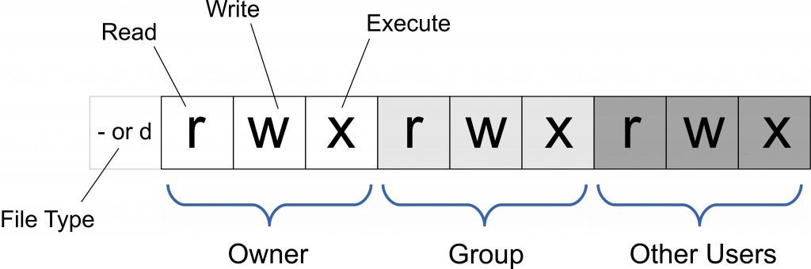
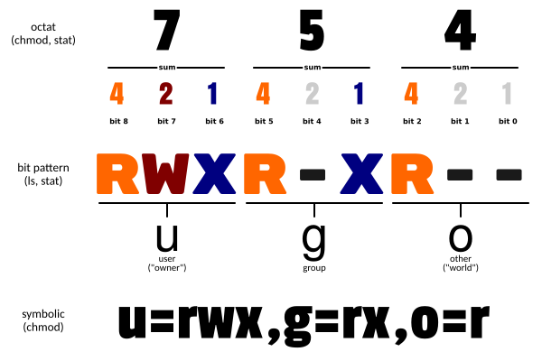

---
tags:
  - Linux基础教程
---

# Linux权限管理


[TOC]

## 一、普通权限

在多用户计算机系统的管理中，权限是指某个特点的用户具有特定的系统资源使用权力，像是文件夹、特定系统指令的使用或存储量的限制。

### 1、概述

#### 1.1、权限类型

- 可读用`r`表示（read）：
   有了可读权限，就可以读取文件的内容
- 可写用`w`表示（write）：
   有了可写权限，就可以在文件中写入或删除内容
- 可执行用`x`表示（execute）：
   有了可执行权限，就可以执行该文件
- `-`表示没有某个权限

| 权限的排列方式 | Linux下表示 | 二进制表示 | 八进制表示 |
| -------------- | ----------- | ---------- | ---------- |
| 只读           | r--         | 100        | 4          |
| 只可写         | -w-         | 010        | 2          |
| 只可执行       | --x         | 001        | 1          |
| 可写可写       | rw-         | 110        | 6          |
| 可读可执行     | r-x         | 101        | 5          |
| 可写可执行     | -wx         | 011        | 3          |
| 可读可写可执行 | rwx         | 111        | 7          |
| 空权限         | ---         | 000        | 0          |

#### 1.2、文件访问者的分类

对于一个文件或目录，在Linux中有三种角色：

- **文件的所有者**：`u`（user）
- **文件所有者的所属组**：`g`（group）
- **其他用户**：`o`（others）

#### 1.3、文件类型

在Linux中，文件有如下几种类型：

- `d`：文件夹
- `-`：普通文件
- `l`：软链接（类似Windows的快捷方式）
- `b`：块设备文件（例如硬盘、光驱等）
- `p`：管道文件
- `c`：字符设备文件（例如屏幕等串口设备）
- `s`：套接口文件


### 2、普通权限管理命令

#### 2.1、chmod命令

Linux chmod（英文全拼：change mode）命令是控制用户对文件的权限的命令。

chmod (change mode) 是 Linux 系统中用于更改文件或目录权限的命令，它控制着文件所有者、所属组和其他用户对文件的访问权限。

只有文件所有者和超级用户可以修改文件或目录的权限。

Linux/Unix 的文件调用权限分为三级 : 文件所有者（Owner）、用户组（Group）、其它用户（Other Users）。




------

可以使用绝对模式（八进制数字模式），符号模式指定文件的权限。




**语法：**

```bash
chmod [选项] 权限模式 文件...
chmod [选项] --reference=参考文件 文件...
```

**选项：**

| 选项      | 作用                                                         |
| --------- | ------------------------------------------------------------ |
| -c        | 若该文件权限确实已经更改，才显示其更改动作                   |
| -f        | 若该文件权限无法被更改也不要显示错误讯息                     |
| -v        | 显示权限变更的详细资料                                       |
| -R        | 对目前目录下的所有文件与子目录进行相同的权限变更(即以递归的方式逐个变更) |
| --help    | 显示辅助说明                                                 |
| --version | 显示版本                                                     |


##### 权限模式

###### 1、符号模式（ugoa+/-权限）

```
[ugoa...][[+-=][rwxX]...][,...]
```

其中：

- u 表示该文件的拥有者，g 表示与该文件的拥有者属于同一个群体(group)者，o 表示其他以外的人，a 表示这三者皆是。
- \+ 表示增加权限、- 表示取消权限、= 表示唯一设定权限。
- r 表示可读取，w 表示可写入，x 表示可执行，X 表示只有当该文件是个子目录或者该文件已经被设定过为可执行。

使用符号模式可以设置多个项目：who（用户类型），operator（操作符）和 permission（权限），每个项目的设置可以用逗号隔开。

命令 chmod 将修改 who 指定的用户类型对文件的访问权限，用户类型由一个或者多个字母在 who 的位置来说明，如 who 的符号模式表所示:

| who  | 用户类型 | 说明                   |
| :--- | :------- | :--------------------- |
| `u`  | user     | 文件所有者             |
| `g`  | group    | 文件所有者所在组       |
| `o`  | others   | 所有其他用户           |
| `a`  | all      | 所有用户, 相当于 *ugo* |

operator 的符号模式表:

| Operator | 说明                                                   |
| :------- | :----------------------------------------------------- |
| `+`      | 为指定的用户类型增加权限                               |
| `-`      | 去除指定用户类型的权限                                 |
| `=`      | 设置指定用户权限的设置，即将用户类型的所有权限重新设置 |

权限类型:

| 模式 | 名字         | 说明                                                         |
| :--- | :----------- | :----------------------------------------------------------- |
| `r`  | 读           | 设置为可读权限                                               |
| `w`  | 写           | 设置为可写权限                                               |
| `x`  | 执行权限     | 设置为可执行权限                                             |
| `X`  | 特殊执行权限 | 只有当文件为目录文件，或者其他类型的用户有可执行权限时，才将文件权限设置可执行 |
| `s`  | setuid/gid   | 当文件被执行时，根据who参数指定的用户类型设置文件的setuid或者setgid权限 |
| `t`  | 粘贴位       | 设置粘贴位，只有超级用户可以设置该位，只有文件所有者u可以使用该位 |

###### 2、八进制语法

chmod 命令可以使用八进制数来指定权限。

| 数字 | 权限    |
| :--- | :------ |
| 4    | 读(r)   |
| 2    | 写(w)   |
| 1    | 执行(x) |

**组合方式**:

- 所有者权限(第一位)
- 组权限(第二位)
- 其他用户权限(第三位)

**常用组合**:

- 755: `rwxr-xr-x`
- 644: `rw-r--r--`
- 700: `rwx------`

文件或目录的权限位是由 9 个权限位来控制，每三位为一组，它们分别是文件所有者（User）的读、写、执行，用户组（Group）的读、写、执行以及其它用户（Other）的读、写、执行。

| #    | 权限           | rwx  | 二进制 |
| :--- | :------------- | :--- | :----- |
| 7    | 读 + 写 + 执行 | rwx  | 111    |
| 6    | 读 + 写        | rw-  | 110    |
| 5    | 读 + 执行      | r-x  | 101    |
| 4    | 只读           | r--  | 100    |
| 3    | 写 + 执行      | -wx  | 011    |
| 2    | 只写           | -w-  | 010    |
| 1    | 只执行         | --x  | 001    |
| 0    | 无             | ---  | 000    |

例如， 765 将这样解释：

- 所有者的权限用数字表达：属主的那三个权限位的数字加起来的总和。如 rwx ，也就是 4+2+1 ，应该是 7。
- 用户组的权限用数字表达：属组的那个权限位数字的相加的总和。如 rw- ，也就是 4+2+0 ，应该是 6。
- 其它用户的权限数字表达：其它用户权限位的数字相加的总和。如 r-x ，也就是 4+0+1 ，应该是 5。


**案例：**

将文件 file1.txt 设为所有人皆可读取 :

```
chmod ugo+r file1.txt
```

将文件 file1.txt 设为所有人皆可读取 :

```
chmod a+r file1.txt
```

将文件 file1.txt 与 file2.txt 设为该文件拥有者，与其所属同一个群体者可写入，但其他以外的人则不可写入 :

```
chmod ug+w,o-w file1.txt file2.txt
```

为 ex1.py 文件拥有者增加可执行权限:

```
chmod u+x ex1.py
```

将目前目录下的所有文件与子目录皆设为任何人可读取 :

```
chmod -R a+r *
```

此外chmod也可以用数字来表示权限如 :

```
chmod 777 file
```

语法为：

```
chmod abc file
```

其中a,b,c各为一个数字，分别表示User、Group、及Other的权限。

r=4，w=2，x=1

- 若要 rwx 属性则 4+2+1=7；
- 若要 rw- 属性则 4+2=6；
- 若要 r-x 属性则 4+1=5。

```
chmod a=rwx file
```

和

```
chmod 777 file
```

效果相同

```
chmod ug=rwx,o=x file
```

和

```
chmod 771 file
```

效果相同

若用 **chmod 4755 filename** 可使此程序具有 root 的权限。

#### 2.2、chown命令

Linux chown（英文全拼：**change owner**）命令用于设置文件所有者和文件关联组的命令。

Linux/Unix 是多人多工操作系统，所有的文件皆有拥有者。利用 chown 将指定文件的拥有者改为指定的用户或组，用户可以是用户名或者用户 ID，组可以是组名或者组 ID，文件是以空格分开的要改变权限的文件列表，支持通配符。

chown 需要超级用户 **root** 的权限才能执行此命令，非超级用户如需要设置关联组可能需要使用 [chgrp](https://www.runoob.com/linux/linux-comm-chgrp.html) 命令。

**使用权限** : root

**语法：**

```bash
chown [选项] 所有者[:组] 文件...
chown [选项] --reference=参考文件 文件...
```

**选项：**

| 选项                 | 作用                                     |
| -------------------- | ---------------------------------------- |
| -R, --recursive      | 递归更改目录及其子目录中所有文件的所有者 |
| -v, --verbose        | 显示详细操作信息                         |
| -c, --changes        | 只显示实际发生更改的文件                 |
| -h, --no-dereference | 影响符号链接本身，而不是链接指向的文件   |


##### 基本使用格式

**1. 只更改所有者**

```
chown username filename
chown john file.txt
```

**2. 同时更改所有者和组**

```
chown username:groupname filename
chown john:developers script.sh
```

**3. 只更改组（所有者前留空）**

```
chown :groupname filename
chown :staff document.txt
```

**4. 使用数字ID**

```
chown 1000:1000 filename    # 用户ID 1000，组ID 1000
chown 1001 filename         # 只更改用户ID
```

**案例：**

把 /var/run/httpd.pid 的所有者设置 root：

```
chown root /var/run/httpd.pid
```

将文件 file1.txt 的拥有者设为 runoob，群体的使用者 runoobgroup :

```
chown runoob:runoobgroup file1.txt
```

将当前前目录下的所有文件与子目录的拥有者皆设为 runoob，群体的使用者 runoobgroup:

```
chown -R runoob:runoobgroup *
```

把 /home/runoob 的关联组设置为 512 （关联组ID），不改变所有者：

```
chown :512 /home/runoob
```

#### 2.3、umask命令

umask可用来设定[权限掩码]。[权限掩码]是由3个八进制的数字所组成，将现有的存取权限减掉权限掩码后，即可产生建立文件时预设的权限。

**语法：**

```bash
umask [-S][权限掩码]
```

**选项：**

| 选项 | 作用                         |
| ---- | ---------------------------- |
| -S   | 以文字的方式来表示权限掩码。 |
|      |                              |
|      |                              |

**案例：**

使用指令"umask"查看当前权限掩码，则输入下面的命令：

```bash
$ umask                         #获取当前权限掩码 
```

执行上面的指令后，输出信息如下：

```bash
0022
```

接下来，使用指令"mkdir"创建一个目录，并使用指令"ls"获取该目录的详细信息，输入命令如下：

```bash
$ mkdir test1                       #创建目录  
$ ls –d –l test1/                   #显示目录的详细信息  
```

执行上面的命令后，将显示新创建目录的详细信息，如下所示：

```bash
drwxr-xr-x 2 root root 4096  6月 6日 17:39 test1/
```

上面的输出信息中，"drwxr-xr-x"="777-022=755"。


## 二、特殊权限

### 1、概述

在linux系统中，我们熟知有rwx三种权限，对应所有者，同组用户，其他用户三种用户的权限，一般而言，这三种权限已经能够满足需求，但是针对一些特殊情况，还需要有三种特殊权限来完善文件权限的管理。

#### 权限类型

#### SUID权限

- set UID，第3位上表现为s。

- 如果该属主权限位上有执行权限，则会显示（小写）s。

- 如果该属主权限位上没有执行权限，则会显示（大写）S。

- 只要一个命令文件在属主权限位上的x变成s的话，那么其它用户在执行这个命令文件时，就会以该命令文件的属主用户身份去执行。
- suid仅对二进制可执行程序有效，其它文件或目录无效。

#### SGID权限

- set GID，第6位上表现为s。
- 如果该属组权限位上有执行权限，则会显示（小写）s。
- 如果该属组权限位上没有执行权限，则会显示（大写）S。
- SGID改变的是执行者的所属组，可以对可执行文件和目录设置。一般情况下是设置给目录使用的，通过对目录设置SGID属性，可以使得访问在该目录下创建的所有文件的所有权，都继承原目录的所有者，而非创建者。因为一旦有用户进入到该目录下，由于具有SGID权限，进入目录后的用户就会变成该目录的所有者，在该目录下创建的所有文件，都以该目录的所有者的身份创建。

#### SBID权限

- SBID权限同样只对目录有效，在权限位的最低位表现为t。
- 如果该其它用户权限位上有执行权限，则会显示（小写）t。
- 如果该其它用户权限位上没有执行权限，则会显示（大写）T。
- 通过对目录设置SBID权限，并且该目录的权限为777，则所有用户可以在该目录下都可以创建文件，并且文件所有者是自己。但是在SBID权限的目录下，只有root和文件的所有者才能删除该文件，即使文件的属性为777也不能被其他用户删除。
- sticky目录表现在others 的 x 位，用（小写）t 表示，没有执行权限时（大写）T，一个目录即使使得它的权限为“777” ，如果设置了粘滞位，除了目录的属主和“root”用户有权限删除，其它用户都不允许删除。

### 2、案例

#### 2.1、SUID权限

**如果普通用户在使用passwd命令时，是以root用户身份去执行的话，那普通用户是不是可以修改其它用户的密码？**
答：是不可以的，因为在passwd命令中，存在一种判断，此判断会在执行passwd命令时去判断执行的用户时是root还是普通用户，如果是普通用户，那么只能使用passwd命令，后面不可加上参数，如果是root用户，后面才可加上其它参数（参数就是用户）。那么普通用户就无法进行修改其它用户的密码。

```bash

[root@centos7 ~]# useradd hello   #创建一个用户
[root@centos7 ~]# passwd hello    #设置它的密码
更改用户 hello 的密码 。
新的 密码：
重新输入新的 密码：
passwd：所有的身份验证令牌已经成功更新。
[root@centos7 ~]# ll /bin/passwd    #查看passwd命令权限
-rwsr-xr-x. 1 root root 27832 6月  10 2014 /bin/passwd

[root@centos7 ~]# su hello     #切换到hello用户  
[hello@centos7 root]$ passwd    #修改密码
更改用户 hello 的密码 。
为 hello 更改 STRESS 密码。
（当前）UNIX 密码：
新的 密码：
重新输入新的密码：
passwd：所有的身份验证令牌已经成功更新。   #可以成功修改

[hello@centos7 root]$ su root    #返回root用户
密码：
[root@centos7 ~]# chmod u-s /bin/passwd   #修改passwd的权限，去掉suid权限
[root@centos7 ~]# ll /bin/passwd
-rwxr-xr-x. 1 root root 27832 6月  10 2014 /bin/passwd   #发现s变成了x

[root@centos7 ~]# su hello   #再切换到hello用户
[hello@centos7 root]$ passwd   #修改密码
更改用户 hello 的密码 。
为 hello 更改 STRESS 密码。
（当前）UNIX 密码：
新的 密码：
重新输入新的 密码： 
passwd: 鉴定令牌操作错误    #密码无法进行修改
```

#### 2.2、SGID权限

```bash
[root@centos7 opt]# mkdir ydq   #创建目录
[root@centos7 opt]# ll
总用量 0
drwxr-xr-x. 2 root root 6 5月  17 00:23 ydq   #查看权限
[root@centos7 opt]# chmod 777 ydq   #查看权限为777
[root@centos7 opt]# ll
总用量 0
drwxrwxrwx. 2 root root 6 5月  17 00:23 ydq   #权限已修改
[root@centos7 opt]# cd ydq   #进入到cd目录
[root@centos7 ydq]# mkdir aaa  #创建aaa文件
[root@centos7 ydq]# ll
总用量 0
drwxr-xr-x. 2 root root 6 5月  17 00:23 aaa  #可以看到aaa文件的属主和数组都是root
[root@centos7 ydq]# su hello    #切换hello用户
[hello@centos7 ydq]$ mkdir bbb   #创建bbb目录
[hello@centos7 ydq]$ ll
总用量 0
drwxr-xr-x. 2 root  root  6 5月  17 00:23 aaa
drwxrwxr-x. 2 hello hello 6 5月  17 00:24 bbb  #可以看到bbb文件的属主和属组都是hello文件
[hello@centos7 ydq]$ exit  #返回root用户
exit
[root@centos7 ydq]# cd ../   #返回上一级
[root@centos7 opt]# chmod g+s ydq   #将ydq目录增加sgid
[root@centos7 opt]# ll
总用量 0
drwxrwsrwx. 4 root root 28 5月  17 00:24 ydq   #属组的权限已增加了s
[root@centos7 opt]# cd ydq   #进入ydq目录
[root@centos7 ydq]# su hello   #切换hello用户
[hello@centos7 ydq]$ mkdir ccc    #创建目录ccc
[hello@centos7 ydq]$ ll
总用量 0
drwxr-xr-x. 2 root  root  6 5月  17 00:23 aaa
drwxrwxr-x. 2 hello hello 6 5月  17 00:24 bbb
drwxrwsr-x. 2 hello root  6 5月  17 00:25 ccc   #ccc的属组用户已变为跟ydq目录一致的用户
```

#### 2.3、SBIT权限

```bash
[root@centos7 opt]# ll    #查看权限
总用量 0
drwxrwxrwx. 2 root root 6 5月  17 09:27 yude   #权限为777
[root@centos7 opt]# chmod o+t yude   #增加sticky bit权限
[root@centos7 opt]# ll   #查看权限
总用量 0
drwxrwxrwt. 2 root root 6 5月  17 09:27 yude   #其它用户上权限多了sticky bit权限
[root@centos7 opt]# cd yude  #进入到yude目录下面

[root@centos7 yude]# su hello    #切换hello用户
[hello@centos7 yude]$ touch bbb    #创建一个文件
[hello@centos7 yude]$ ll    #查看文件，文件正常创建
总用量 0
-rw-rw-r--. 1 hello hello 0 5月  17 09:39 bbb    

[hello@centos7 yude]$ exit   #退出当前用户
exit
[root@centos7 yude]# su ydq    #切换到ydq用户
[ydq@centos7 yude]$ ll
总用量 0
-rw-rw-r--. 1 hello hello 0 5月  17 09:39 bbb   #可以查看到hello用户创建的文件
[ydq@centos7 yude]$ rm -rf ./bbb   #进行删除bbb文件
rm: 无法删除"./bbb": 不允许的操作     #无法进行删除

```


## 三、ACL权限

### 1、概述

读、写、执行权限是用户操作文件、目录的权限。ACL权限也是用户对文件是否有读、写、执行的权限。目录或文件的所有者、所属组、其他人的权限都已经设定，但是如果想要让新用户对文件、目录有不同的权限（不同于所有者、所属组、其他人的权限），为了满足这种特殊的需求，需要对用户单独设置ACL权限。是否支持ACL权限，不是文件支持也不是用户支持，而是文件所在的分区是否支持ACL权限。

查看分区ACL权限是否开启dumpe2fs

```bash
dumpe2fs -h 分区
```

### 2、管理命令

#### 2.1、setfacl命令

**语法：**

```bash

```

**选项：**

| 选项 | 作用 |
| ---- | ---- |
|      |      |
|      |      |
|      |      |

**案例：**

#### 2.2、getfacl命令

**语法：**

```bash

```

**选项：**

| 选项 | 作用 |
| ---- | ---- |
|      |      |
|      |      |
|      |      |

**案例：**


