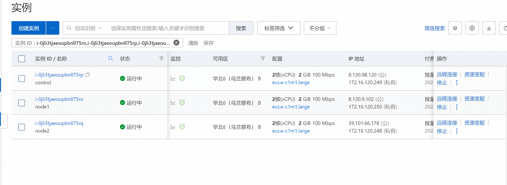
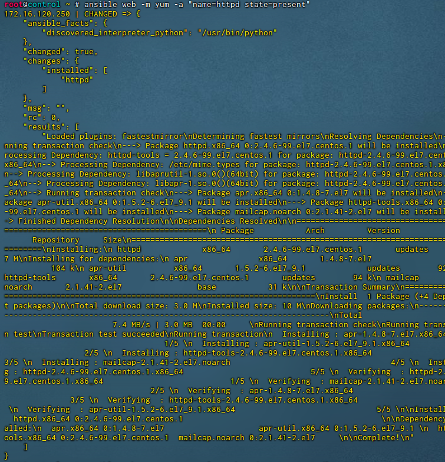
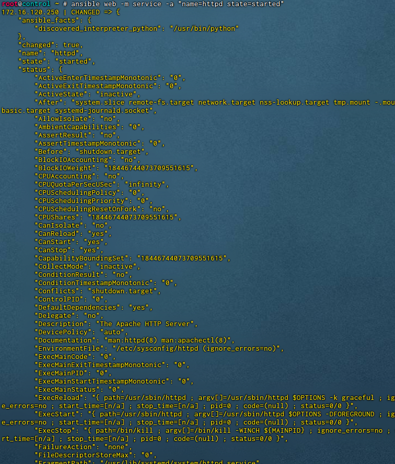
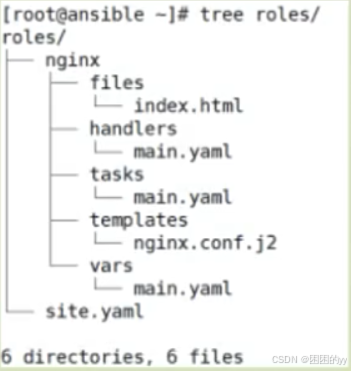
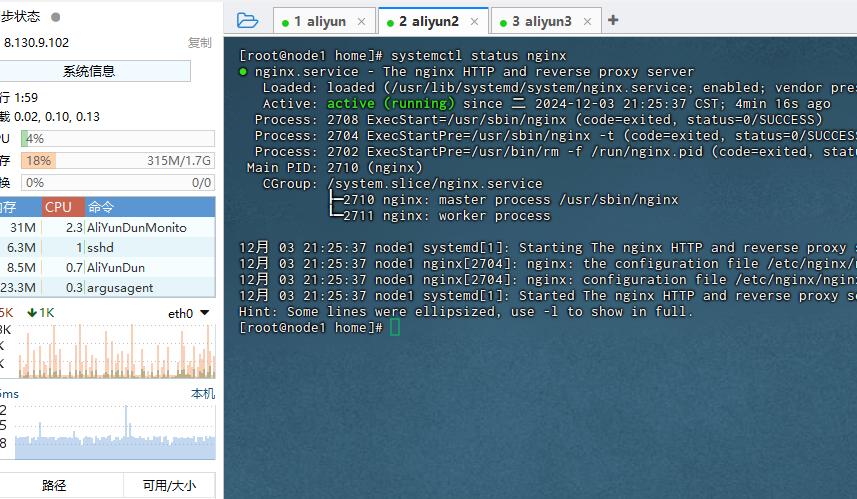

---
tags:
  - ansible
  - 自动化
---

# ansible基础


1.软件介绍


环境准备，密码都是Gww603397654

| <font style="color:rgb(38, 38, 38);">主机名</font><font style="color:rgb(38, 38, 38);">   </font> | <font style="color:rgb(38, 38, 38);">系统</font> | <font style="color:rgb(38, 38, 38);">IP地址</font><font style="color:rgb(38, 38, 38);">   </font> | <font style="color:rgb(38, 38, 38);">角色</font><font style="color:rgb(38, 38, 38);">   </font> |
| :---: | :---: | :---: | :---: |
| <font style="color:rgb(38, 38, 38);">control</font><font style="color:rgb(38, 38, 38);">   </font> | <font style="color:rgb(38, 38, 38);">centos7.9</font> | <font style="color:rgb(38, 38, 38);">172.16.120.249   </font> | <font style="color:rgb(38, 38, 38);">控制节点（manager）</font><font style="color:rgb(38, 38, 38);">   </font> |
| <font style="color:rgb(38, 38, 38);">node1</font><font style="color:rgb(38, 38, 38);">   </font> | <font style="color:rgb(38, 38, 38);">centos7.9</font> | <font style="color:rgb(38, 38, 38);">172.16.120.250   </font> | <font style="color:rgb(38, 38, 38);">被控制节点（web2）</font><font style="color:rgb(38, 38, 38);">   </font> |
| <font style="color:rgb(38, 38, 38);">node2</font><font style="color:rgb(38, 38, 38);">   </font> | <font style="color:rgb(38, 38, 38);">centos7.9</font> | <font style="color:rgb(38, 38, 38);">172.16.120.248   </font> | <font style="color:rgb(38, 38, 38);">被控制节点（database）</font> |




在这三台服务器上使用 Ansible 来学习自动化操作是一个很好的实践。下面我将指导你如何使用这三台 CentOS 7.9 服务器配置并执行基础的 Ansible 操作。

### 1. **准备工作**
首先，确保你的所有服务器都可以相互通信，并且能够通过 SSH 登录。根据你提供的 IP 地址，它们应该能够互相访问。

修改三台服务器的主机名。便于后期查看

```bash
sudo hostnamectl set-hostname <新的主机名>
```

<font style="color:rgb(31, 35, 41);"></font>

### 2. **安装 Ansible**
在 **控制节点 (control)** 上安装 Ansible：

```bash
sudo yum update -y
sudo yum install epel-release -y
sudo yum install ansible -y
```

通过运行 `ansible --version` 验证 Ansible 是否安装成功。

```bash
ansible --version
```

### 3. **配置 SSH 免密登录**
为了让 Ansible 能够无密码地管理所有节点，你需要在控制节点上为 Ansible 配置 SSH 密钥对。

#### 生成 SSH 密钥对（如果尚未生成）
在 **控制节点 (control)** 上执行以下命令：

```bash
ssh-keygen -t rsa
```

按提示操作，一般直接按回车即可。

#### 将 SSH 公钥复制到所有被控制节点
使用 `ssh-copy-id` 将公钥复制到 `node1` 和 `node2` 上，分别执行以下命令：

```bash
ssh-copy-id 172.16.120.250
ssh-copy-id 172.16.120.248
ssh-copy-id 172.16.120.249
```

输入每台服务器的密码（你提供的密码是 `Gww603397654`）以完成 SSH 免密登录配置。

你可以通过运行以下命令测试免密登录是否成功：

```bash
ssh 172.16.120.250
ssh 172.16.120.248
ssh 172.16.120.249
```

如果你能够直接登录而不输入密码，则说明免密登录配置成功。

```bash
root@control ~ # ssh 172.16.120.250
Last login: Tue Dec  3 19:58:11 2024 from 110.184.149.83

Welcome to Alibaba Cloud Elastic Compute Service !

[root@node1 ~]# exit
登出
Connection to 172.16.120.250 closed.
root@control ~ # ssh 172.16.120.248
Last login: Tue Dec  3 19:58:42 2024 from 110.184.149.83

Welcome to Alibaba Cloud Elastic Compute Service !

[root@node2 ~]# exit
登出
Connection to 172.16.120.248 closed.
root@control ~ # 
root@control ~ # ssh 172.16.120.249
Last login: Tue Dec  3 19:59:55 2024 from 110.184.149.83

Welcome to Alibaba Cloud Elastic Compute Service !

root@control ~ # exit
登出
Connection to 172.16.120.249 closed.
root@control ~ # 

```

### 4. **配置 Ansible 主机清单 (inventory)**
Ansible 使用一个清单文件来定义所有受管理节点的 IP 地址和主机名。你需要在 **控制节点 (control)** 上创建一个清单文件。

编辑 `/etc/ansible/hosts` 文件（如果文件不存在，可以创建它）：

```bash
sudo vim /etc/ansible/hosts
```

将以下内容添加到文件中：

```properties
[all:vars]
ansible_user=root
#ansible_ssh_pass=Gww603397654  这里可以不写密码
ansible_become=true

[control]
172.16.120.249

[nodes]
172.16.120.250
172.16.120.248

[web]
172.16.120.250

[database]
172.16.120.248

```

这个文件定义了两个组：`web` 和 `database`，分别包含 `node1` 和 `node2` 的 IP 地址。

### 5. **验证 Ansible 配置**
现在，你可以通过运行 `ansible` 命令来测试连接是否成功。首先测试控制节点是否能够成功连接到所有被控制节点：

```bash
ansible all -m ping
```

如果一切设置正确，你应该看到类似下面的输出，表示所有节点的连接成功：

```bash
172.16.120.249 | SUCCESS | rc=0 >>
pong
172.16.120.250 | SUCCESS | rc=0 >>
pong
172.16.120.248 | SUCCESS | rc=0 >>
pong
```

### 6. **执行基本的 Ansible 操作（****<font style="color:#DF2A3F;">常用模块</font>****）**
接下来，你可以尝试一些基本的 Ansible 操作。

<font style="color:#DF2A3F;">详细的模块学习可以参考</font>

[【小菜鸟之---Ansible基础详解】-CSDN博客](https://blog.csdn.net/FWT975959/article/details/138420460?ops_request_misc=&request_id=&biz_id=102&utm_term=ansible%E5%9F%BA%E7%A1%80&utm_medium=distribute.pc_search_result.none-task-blog-2~all~sobaiduweb~default-4-138420460.142^v100^pc_search_result_base6&spm=1018.2226.3001.4187)

#### 6.1. **运行一个简单的命令**
使用 `ansible` 命令来执行一个简单的操作，比如获取 `node1` 和 `node2` 的主机名：

```bash
ansible all -m command -a "hostname"
```

这将会在所有节点上运行 `hostname` 命令，显示各节点的主机名。

#### 6.2. **安装软件包yum和**<font style="color:rgb(40, 105, 201);background-color:rgb(253, 253, 253);">service模块</font>
可以使用 Ansible 的 `yum` 模块来安装软件包。例如，安装 `httpd`（Apache Web 服务器）：

```bash
ansible web -m yum -a "name=httpd state=present"
```

这个命令将在 `web` 组中的所有节点上安装 Apache Web 服务器。如果需要，你可以验证安装是否成功：

```bash
ansible web -m service -a "name=httpd state=started"
```

这将确保 Apache 服务启动并运行。

其他命令

```bash
ansible web -m service -a 'name=httpd state=started enabled=yes'   ####开机自启动

ansible web -m service -a 'name=httpd state=stoped'  ###停止

ansible web -m service -a 'name=httpd state=restarted'  ####重启
```



#### 6.3. **拷贝文件**
使用 `copy` 模块将文件从控制节点复制到被控制节点。例如，将一个本地文件复制到 `node1`：

```bash
ansible web -m copy -a "src=/path/to/local/file dest=/path/to/remote/file"
```

另外如果是想从远程机器拿文件到控制端可以使用下面的命令

```bash
ansible web -m fetch -a 'src=/tmp/1.txt dest=root'
```

```bash
root@control / # ls
bin   dev  home  lib64       media  opt   root  sbin  sys  usr
boot  etc  lib   lost+found  mnt    proc  run   srv   tmp  var
root@control / # cd /home
root@control /home # ls
root@control /home # touch 1.txt
root@control /home # ls
1.txt
root@control /home # ansible web -m copy -a "src=/home/1.txt dest=/home"
172.16.120.250 | CHANGED => {
    "ansible_facts": {
        "discovered_interpreter_python": "/usr/bin/python"
    }, 
    "changed": true, 
    "checksum": "da39a3ee5e6b4b0d3255bfef95601890afd80709", 
    "dest": "/home/1.txt", 
    "gid": 0, 
    "group": "root", 
    "md5sum": "d41d8cd98f00b204e9800998ecf8427e", 
    "mode": "0644", 
    "owner": "root", 
    "size": 0, 
    "src": "/root/.ansible/tmp/ansible-tmp-1733228354.96-23809-115754000292483/source", 
    "state": "file", 
    "uid": 0
}
root@control /home # 

```

#### 6.4. **执行 playbook**
你还可以编写 Ansible Playbook 来自动化更复杂的任务。首先，创建一个简单的 playbook 文件 `example.yml`：

```yaml
---
- name: Install and start Apache on web nodes
  hosts: web
  become: true
  tasks:
    - name: Install httpd
      yum:
        name: httpd
        state: present
    - name: Start httpd service
      service:
        name: httpd
        state: started
```

```bash
root@control /home # ansible-playbook example.yml --list-hosts
#列出主机
playbook: example.yml

  play #1 (web): Install and start Apache on web nodes  TAGS: []
    pattern: [u'web']
    hosts (1):
      172.16.120.250
root@control /home # ansible-playbook example.yml --list-tasks
#列出任务
playbook: example.yml

  play #1 (web): Install and start Apache on web nodes  TAGS: []
    tasks:
      Install httpd     TAGS: []
      Start httpd service       TAGS: []
root@control /home # 
root@control /home # ansible-playbook example.yml --syntax-check
#检查语法
playbook: example.yml

```

然后运行这个 playbook：

```bash
ansible-playbook example.yml
```

这个 playbook 会在所有 `web` 节点上安装并启动 Apache 服务。

```bash
root@control /home # ansible-playbook example.yml

PLAY [Install and start Apache on web nodes] ******************************************************

TASK [Gathering Facts] ****************************************************************************
ok: [172.16.120.250]

TASK [Install httpd] ******************************************************************************
ok: [172.16.120.250]

TASK [Start httpd service] ************************************************************************
ok: [172.16.120.250]

PLAY RECAP ****************************************************************************************
172.16.120.250             : ok=3    changed=0    unreachable=0    failed=0    skipped=0    rescued=0    ignored=0   


```

#### 6.5查看各节点负载
```bash
root@control /home # ansible all -a "uptime"
172.16.120.248 | CHANGED | rc=0 >>
 20:23:54 up 53 min,  3 users,  load average: 0.04, 0.07, 0.05
172.16.120.250 | CHANGED | rc=0 >>
 20:23:54 up 53 min,  3 users,  load average: 0.53, 0.30, 0.22
172.16.120.249 | CHANGED | rc=0 >>
 20:23:54 up 26 min,  3 users,  load average: 0.09, 0.11, 0.07
root@control /home # 


```

#### 6.6用户模块
```bash
（1）创建用户

ansible web -m user -a 'name=test state=present'

（2）修改密码

生成加密密码

[root@ansible ~]# echo '123456' |openssl passwd -1 stdin
$1$bYfCvrIS$YnSldRWGYs3/DQTgFUH.9.

ansible web -m user -a 'name=test password="$1$bYfCvrIS$YnSldRWGYs3/DQTgFUH.9." append=yes' 
###append表示追加，这个参数告诉 Ansible 如果用户 test 已经存在，则追加信息而不是替换现有的用户信息。如果设置为 no，则每次运行命令时都会替换用户密码
（3）修改shell

ansible web -m user -a 'name=test shell=/sbin/nologin append=yes'
#/sbin/nologin 是一个特殊的 shell，它不允许用户登录系统。这通常用于限制某些用户只能通过特定服务（如某些守护进程）与系统交互，而不允许直接登录。
（4）删除用户

ansible web -m user -a 'name=test state=absent'
```


#### 6.7文件模块
```bash
copy模块，src(管理机器上 )  dest(目标机器上)

file专门用于在远程机器上，关于文件的所有操作
file  src(目标机器上的文件)   dest(目标机器上的文件)  

file模块主要用于创建文件、目录数据，以及对现有的文件、目录权限进行修改

创建文件

ansible web -m file -a 'path=/tmp/666.txt mode=777 state=touch'

删除文件

ansible web -m file -a 'path=/tmp/666.txt state=absent'

创建文件夹

ansible web -m file -a 'path=/tmp/test mode=777 state=directory'

删除文件夹

ansible web -m file -a 'path=/tmp/test state=absent'
```


#### 6.8收集模块
```bash
查询所有信息，内容很多，将会显示web服务器172.16.120.250的硬件信息。

ansible web -m setup

filter可以过滤出想要的信息，比如下面的过滤出地址

ansible web -m setup -a 'filter=ansible_all_ipv4_addresses'
```


#### 6.9cron定时任务模块
```bash
ansible创建定时任务

ansible web -m cron -a 'name="sync time from ntpserver" minute="*/10" job="/usr/sbin/ntpdate 172.17.0.1 &>/dev/null"'

ansible删除定时任务

ansible web -m cron -a 'name="sync time from ntpserver" minute="*/10" job="/usr/sbin/ntpdate 172.17.0.1 &>/dev/null" state=absent'

#为所有目标主机设置一个每5分钟运行一次的cron任务，任务名称为ntp aliyun，执行的命令为ntpdate -u ntp.aliyun.com，用于从阿里云的NTP服务器同步时间。

ansible all -m cron -a "name='ntp aliyun' minute='*/5' job='ntpdate -u ntp.aliyun.com'"
```


#### 6.10 shell模块（万能模块）
解决command模块无法识别的一些命令

```bash
shell模块直接调用shell指令批量在节点上执行

以下是删除节点上的/tmp/vmware-root* 文件夹的一个例子

ansible web -m shell -a 'rm -rf /tmp/vmware-root*'

root@control /home # ansible web -m shell -a "date '+%F %T' > /tmp/date.log"
172.16.120.250 | CHANGED | rc=0 >>
#远程获取时间信息，且写入到文件中
root@control /home # ansible web -m shell -a 'cat /tmp/date.log'
172.16.120.250 | CHANGED | rc=0 >>
2024-12-04 16:23:46
root@control /home # 

通过一条命令，做如下事情

- 创建文件夹
- 生成sh脚本文件(查看主机名)
- 赋予脚本可执行权限
- 执行脚本
- 忽略warning信息

ansible web  -m shell  -a "mkdir /0224/;echo 'hostname' > /0224/hostname.sh;chmod +x /0224/hostname.sh;/0224/hostname.sh;  warn=false"
```


### 7.role-角色扮演
#### 7.1简介
<font style="color:rgb(77, 77, 77);">roles是在ansible中，playbook的目录组织结构。</font>

<font style="color:rgb(77, 77, 77);">将代码或文件进行模块化，成为roles的文件目录组织结构。</font>

<font style="color:rgb(77, 77, 77);">易读，代码可重用，层次清晰。</font>

<font style="color:#DF2A3F;">目标是：通过role远程部署nginx并配置</font>



#### <font style="color:rgb(77, 77, 77);">7.2准备目录结构</font>
```bash
root@control /home # yum install -y tree
root@control /home # mkdir -p roles/nginx/{files,handlers,tasks,templates,vars}
root@control /home # touch roles/site.yaml
root@control /home # touch roles/nginx/files/index.html
root@control /home # echo 123456789 >> roles/nginx/files/index.html
root@control /home # touch roles/nginx/{handlers,tasks,vars}/main.yaml
root@control /home # tree roles/
roles/
├── nginx
│   ├── files
│   │   └── index.html
│   ├── handlers
│   │   └── main.yaml
│   ├── tasks
│   │   └── main.yaml
│   ├── templates
│   └── vars
│       └── main.yaml
└── site.yaml

6 directories, 5 files
root@control /home # 


```

#### 7.3编写任务
```bash
root@control /home/roles/nginx/vars # cd /home/roles/nginx/vars
root@control /home/roles/nginx/vars # ls
main.yaml
root@control /home/roles/nginx/vars # 
root@control /home/roles/nginx/vars # vim main.yaml 
root@control /home/roles/nginx/vars # cat main.yaml 
--- 
- name: install epel-release package
  yum: name=epel-release state=latest

- name: install nginx
  yum: name=nginx state=latest

- name: copy index.html
  copy: src=/home/roles/nginx/files/index.html dest=/usr/share/nginx/html/index.html
#这里注意把路径改成自己的实际路径
- name: copy nginx conf
  template: src=nginx.conf.j2 dest=/etc/nginx/nginx.conf
  notify: restart nginx

- name: start nginx
  service: name=nginx state=started enabled=yes
root@control /home/roles/nginx/vars # 


```

#### 7.4准备配置文件
```bash
root@control /home/roles/nginx/vars # yum install nginx -y && cp -rp /etc/nginx/nginx.conf /home/roles/nginx/templates/nginx.conf.j2

```


#### 7.5编写变量
```bash
vim /home/roles/nginx/templates/nginx.conf.j2
worker_processor {{ ansible_processor_cores }}    ######调用已知内部变量

[root@ansible vars]# cat main.yaml    ####自定义变量
worker_connections: 10234

```

#### <font style="color:rgb(79, 79, 79);">7.6编写处理程序</font>
```plain
[root@ansible handlers]# cat main.yaml 
---
- name: restart nginx
  service: name=nginx state=restarted

```

#### <font style="color:rgb(79, 79, 79);">7.7编写剧本</font>
```plain
[root@ansible roles]# cat site.yaml 
- hosts: web
  roles:
  - nginx
```

#### <font style="color:rgb(79, 79, 79);">7.8实施</font>
```shell
ansible-playbook site.yaml --syntax-check      ####检查语法错误
ansible-playbook site.yaml     ####执行剧本
```

<font style="color:#DF2A3F;">注意：以上yaml文件到对应的路径下修改，而不是改一个yaml，</font>

<font style="color:#DF2A3F;">至此，目录树里面的配置都改完了</font>

#### 7.9测试
```plain
root@control /home/roles # ls
nginx  site.yaml
root@control /home/roles # ansible-playbook site.yaml

PLAY [web] ****************************************************************************************

TASK [Gathering Facts] ****************************************************************************
ok: [172.16.120.250]

TASK [nginx : install epel-release package] *******************************************************
ok: [172.16.120.250]

TASK [install nginx] ******************************************************************************
ok: [172.16.120.250]

TASK [nginx : copy index.html] ********************************************************************
ok: [172.16.120.250]

TASK [copy nginx conf] ****************************************************************************
ok: [172.16.120.250]

TASK [start nginx] ********************************************************************************
changed: [172.16.120.250]

PLAY RECAP ****************************************************************************************
172.16.120.250             : ok=6    changed=1    unreachable=0    failed=0    skipped=0    rescued=0    ignored=0   

root@control /home/roles # 

```





基础语法


```bash
root@control /home/roles # ansible web -m shell -a 'ls /opt'
172.16.120.250 | CHANGED | rc=0 >>

root@control /home/roles # ansible web -m shell -a 'systemctl status nginx'
172.16.120.250 | CHANGED | rc=0 >>
● nginx.service - The nginx HTTP and reverse proxy server
   Loaded: loaded (/usr/lib/systemd/system/nginx.service; enabled; vendor preset: disabled)
   Active: active (running) since 二 2024-12-03 21:25:37 CST; 7min ago
  Process: 2708 ExecStart=/usr/sbin/nginx (code=exited, status=0/SUCCESS)
  Process: 2704 ExecStartPre=/usr/sbin/nginx -t (code=exited, status=0/SUCCESS)
  Process: 2702 ExecStartPre=/usr/bin/rm -f /run/nginx.pid (code=exited, status=0/SUCCESS)
 Main PID: 2710 (nginx)
   CGroup: /system.slice/nginx.service
           ├─2710 nginx: master process /usr/sbin/ngin
           └─2711 nginx: worker proces

12月 03 21:25:37 node1 systemd[1]: Starting The nginx HTTP and reverse proxy server...
12月 03 21:25:37 node1 nginx[2704]: nginx: the configuration file /etc/nginx/nginx.conf syntax is ok
12月 03 21:25:37 node1 nginx[2704]: nginx: configuration file /etc/nginx/nginx.conf test is successful
12月 03 21:25:37 node1 systemd[1]: Started The nginx HTTP and reverse proxy server.
root@control /home/roles # 


```


> 更新: 2024-12-04 16:37:24  
> 原文: <https://www.yuque.com/xianzhou-eiffx/aklhoc/vsz13ega7edlk67l>