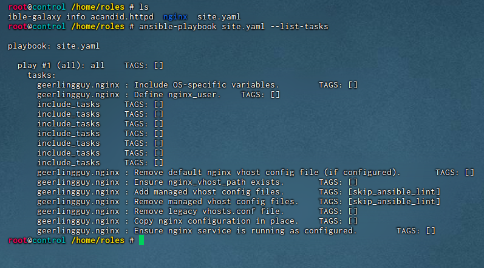
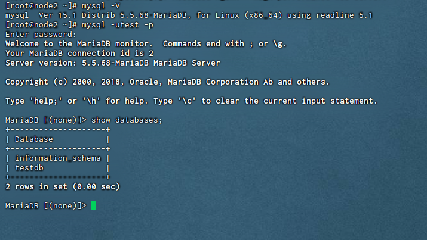

---
tags:
  - ansible
  - role
---

# 使用ansible安装Ansible Galaxy的roles

书接上回

<font style="color:rgb(38, 38, 38);">https://www.yuque.com/xianzhou-eiffx/aklhoc/vsz13ega7edlk67l?singleDoc# 《ansible基础》</font>

<font style="color:rgb(38, 38, 38);">在安装好以上环境后</font>

Ansible Galaxy 是 Ansible 的一个社区平台，你可以在上面找到、下载、分享和使用由其他用户创建的 Ansible Role。Role 是一种将任务、处理器、变量和文件组织在一起的方式，便于重用和分享 Ansible 配置。

<font style="color:rgb(38, 38, 38);">要使用 Ansible Galaxy 里面的内容，你可以按照以下步骤操作：</font>

### <font style="color:rgb(38, 38, 38);">1. 浏览 Ansible Galaxy</font>
<font style="color:rgb(38, 38, 38);">首先，访问 </font>[Ansible Galaxy](https://galaxy.ansible.com/)<font style="color:rgb(38, 38, 38);"> 网站。在这里，你可以搜索你感兴趣的 Role，阅读它们的描述、README 文件、评分和评论，以及查看它们的源代码。</font>

# <font style="color:rgb(38, 38, 38);">一.案例1，给所有主机安装nginx</font>
### <font style="color:rgb(38, 38, 38);">2. 安装 Role</font>
<font style="color:rgb(38, 38, 38);">找到你想要使用的 Role 后，你可以通过 Ansible Galaxy CLI（命令行界面）或者通过 Galaxy 网站的 UI 来安装它。这里介绍使用 CLI 的方法：</font>

+ **通过 Ansible Galaxy CLI 安装 Role**<font style="color:rgb(38, 38, 38);">首先，确保你的系统上已经安装了 </font>`<font style="color:rgb(38, 38, 38);">ansible-galaxy</font>`<font style="color:rgb(38, 38, 38);"> 命令。然后，你可以使用以下命令来安装 Role：</font>

```bash
ansible-galaxy install <username>.<rolename>
```

<font style="color:rgb(38, 38, 38);">其中 </font>`<font style="color:rgb(38, 38, 38);"><username></font>`<font style="color:rgb(38, 38, 38);"> 是 Role 作者的用户名，</font>`<font style="color:rgb(38, 38, 38);"><rolename></font>`<font style="color:rgb(38, 38, 38);"> 是 Role 的名称。例如，如果你想要安装一个名为 </font>`<font style="color:rgb(38, 38, 38);">geerlingguy.nginx</font>`<font style="color:rgb(38, 38, 38);"> 的 Role，你可以运行：</font>

```bash
ansible-galaxy install geerlingguy.nginx
```

<font style="color:rgb(38, 38, 38);">Role 将会被安装到你的 Ansible 环境中的 </font>`<font style="color:rgb(38, 38, 38);">roles</font>`<font style="color:rgb(38, 38, 38);"> 目录下（默认情况下是当前工作目录下的 </font>`<font style="color:rgb(38, 38, 38);">roles</font>`<font style="color:rgb(38, 38, 38);"> 子目录）。</font>

### <font style="color:rgb(38, 38, 38);">3. 使用 Role</font>
<font style="color:rgb(38, 38, 38);">安装完 Role 后，你可以在你的 Ansible Playbook 中引用它。创建一个新的 Playbook 文件（例如 </font>`<font style="color:rgb(38, 38, 38);">site.yml</font>`<font style="color:rgb(38, 38, 38);">），然后在其中使用 </font>`<font style="color:rgb(38, 38, 38);">roles</font>`<font style="color:rgb(38, 38, 38);"> 关键字来包含 Role：</font>

```yaml
- hosts: all
  roles:
    - geerlingguy.nginx
```

<font style="color:rgb(38, 38, 38);">这个 Playbook 将会在所有主机上应用 </font>`<font style="color:rgb(38, 38, 38);">geerlingguy.nginx</font>`<font style="color:rgb(38, 38, 38);"> Role。</font>

### <font style="color:rgb(38, 38, 38);">4. 运行 Playbook</font>
<font style="color:rgb(38, 38, 38);">最后，使用 </font>`<font style="color:rgb(38, 38, 38);">ansible-playbook</font>`<font style="color:rgb(38, 38, 38);"> 命令来运行你的 Playbook：</font>

```bash
ansible-playbook site.yaml
```

<font style="color:rgb(38, 38, 38);">根据你的 Role 和 Playbook 的配置，Ansible 将会在被控制节点上执行相应的任务。</font>

```bash
root@control /home/roles # ansible-galaxy install geerlingguy.nginx
- downloading role 'nginx', owned by geerlingguy
- downloading role from https://github.com/geerlingguy/ansible-role-nginx/archive/3.2.0.tar.gz
- extracting geerlingguy.nginx to /root/.ansible/roles/geerlingguy.nginx
- geerlingguy.nginx (3.2.0) was installed successfully
root@control /home/roles # vim site.yaml 
root@control /home/roles # ansible-playbook site.yml
ERROR! the playbook: site.yml could not be found
root@control /home/roles # ls
ible-galaxy info acandid.httpd  nginx  site.yaml
root@control /home/roles # cat site.yaml 
- hosts: all
  roles:
    - geerlingguy.nginx
root@control /home/roles # ansible-galaxy list
# /root/.ansible/roles
- geerlingguy.nginx, 3.2.0
# /usr/share/ansible/roles
# /etc/ansible/roles
root@control /home/roles # ansible-playbook site.yaml

PLAY [all] ****************************************************************************************

TASK [Gathering Facts] ****************************************************************************
ok: [172.16.120.248]
ok: [172.16.120.250]
ok: [172.16.120.249]

TASK [geerlingguy.nginx : Include OS-specific variables.] *****************************************
ok: [172.16.120.249]
ok: [172.16.120.250]
ok: [172.16.120.248]

TASK [geerlingguy.nginx : Define nginx_user.] *****************************************************
ok: [172.16.120.249]
ok: [172.16.120.250]
ok: [172.16.120.248]

TASK [geerlingguy.nginx : include_tasks] **********************************************************
included: /root/.ansible/roles/geerlingguy.nginx/tasks/setup-RedHat.yml for 172.16.120.249, 172.16.120.250, 172.16.120.248

TASK [geerlingguy.nginx : Enable nginx repo.] *****************************************************
changed: [172.16.120.248]
changed: [172.16.120.250]
changed: [172.16.120.249]

TASK [geerlingguy.nginx : Ensure nginx is installed.] *********************************************
ok: [172.16.120.249]
changed: [172.16.120.248]
changed: [172.16.120.250]

TASK [geerlingguy.nginx : include_tasks] **********************************************************
skipping: [172.16.120.249]
skipping: [172.16.120.250]
skipping: [172.16.120.248]

TASK [geerlingguy.nginx : include_tasks] **********************************************************
skipping: [172.16.120.249]
skipping: [172.16.120.250]
skipping: [172.16.120.248]

TASK [geerlingguy.nginx : include_tasks] **********************************************************
skipping: [172.16.120.249]
skipping: [172.16.120.250]
skipping: [172.16.120.248]

TASK [geerlingguy.nginx : include_tasks] **********************************************************
skipping: [172.16.120.249]
skipping: [172.16.120.250]
skipping: [172.16.120.248]

TASK [geerlingguy.nginx : include_tasks] **********************************************************
skipping: [172.16.120.249]
skipping: [172.16.120.250]
skipping: [172.16.120.248]

TASK [geerlingguy.nginx : include_tasks] **********************************************************
skipping: [172.16.120.249]
skipping: [172.16.120.250]
skipping: [172.16.120.248]

TASK [geerlingguy.nginx : Remove default nginx vhost config file (if configured).] ****************
skipping: [172.16.120.249]
skipping: [172.16.120.250]
skipping: [172.16.120.248]

TASK [geerlingguy.nginx : Ensure nginx_vhost_path exists.] ****************************************
ok: [172.16.120.250]
ok: [172.16.120.248]
ok: [172.16.120.249]

TASK [geerlingguy.nginx : Add managed vhost config files.] ****************************************

TASK [geerlingguy.nginx : Remove managed vhost config files.] *************************************

TASK [geerlingguy.nginx : Remove legacy vhosts.conf file.] ****************************************
ok: [172.16.120.248]
ok: [172.16.120.250]
ok: [172.16.120.249]

TASK [geerlingguy.nginx : Copy nginx configuration in place.] *************************************
changed: [172.16.120.248]
changed: [172.16.120.250]
changed: [172.16.120.249]

TASK [geerlingguy.nginx : Ensure nginx service is running as configured.] *************************
changed: [172.16.120.248]
changed: [172.16.120.250]
changed: [172.16.120.249]

RUNNING HANDLER [geerlingguy.nginx : reload nginx] ************************************************
changed: [172.16.120.248]
changed: [172.16.120.250]
changed: [172.16.120.249]

PLAY RECAP ****************************************************************************************
172.16.120.248             : ok=11   changed=5    unreachable=0    failed=0    skipped=9    rescued=0    ignored=0   
172.16.120.249             : ok=11   changed=4    unreachable=0    failed=0    skipped=9    rescued=0    ignored=0   
172.16.120.250             : ok=11   changed=5    unreachable=0    failed=0    skipped=9    rescued=0    ignored=0   

root@control /home/roles # 

```



##### <font style="color:rgb(6, 6, 7);">这些任务展示了 </font>`<font style="color:rgb(6, 6, 7);">geerlingguy.nginx</font>`<font style="color:rgb(6, 6, 7);"> 角色的主要功能，包括配置 Nginx 用户、管理虚拟主机配置文件、复制 Nginx 配置文件以及确保 Nginx 服务正确运行。通过这些任务，你可以自动化 Nginx 的安装和配置过程。</font>


# 二.案例2，给node2（database）服务器（172.16.120.250）安装mysql
```bash
root@control /home/roles # ansible-galaxy install geerlingguy.mysql
- downloading role 'mysql', owned by geerlingguy
- downloading role from https://github.com/geerlingguy/ansible-role-mysql/archive/4.3.4.tar.gz
- extracting geerlingguy.mysql to /root/.ansible/roles/geerlingguy.mysql
- geerlingguy.mysql (4.3.4) was installed successfully
root@control /home/roles # ls
ible-galaxy info acandid.httpd  nginx  site.yaml
root@control /home/roles # vim site.yaml 
root@control /home/roles # cat site.yaml 
---
- hosts: database
  become: yes
  roles:
    - geerlingguy.mysql
  vars:
    mysql_root_password: 'Gww603397654'
    mysql_databases:
      - name: testdb
        encoding: utf8
        collation: utf8_general_ci
    mysql_users:
      - name: test
        password: 'Gww603397654'
        priv: 'testdb.*:ALL'
    mysql_remove_test_database: true
root@control /home/roles # ansible-playbook site.yaml 
changed: [172.16.120.248]

PLAY RECAP ****************************************************************************************
172.16.120.248             : ok=35   changed=10   unreachable=0    failed=0    skipped=16   rescued=0    ignored=0   

root@control /home/roles # 

```




> 更新: 2024-12-03 22:18:35  
> 原文: <https://www.yuque.com/xianzhou-eiffx/aklhoc/ggbqdhnn8l6ewy65>