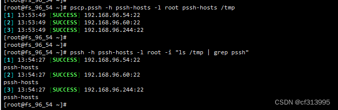
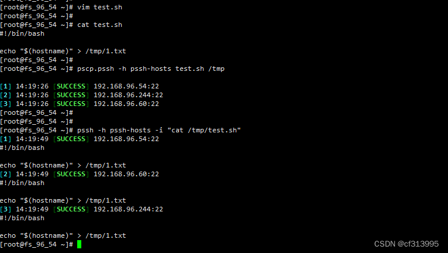
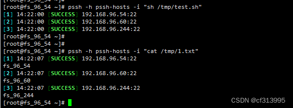
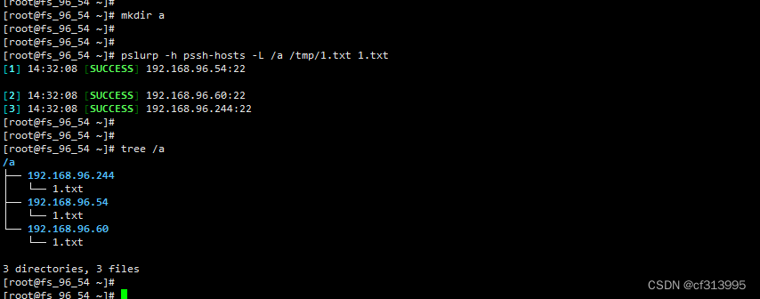
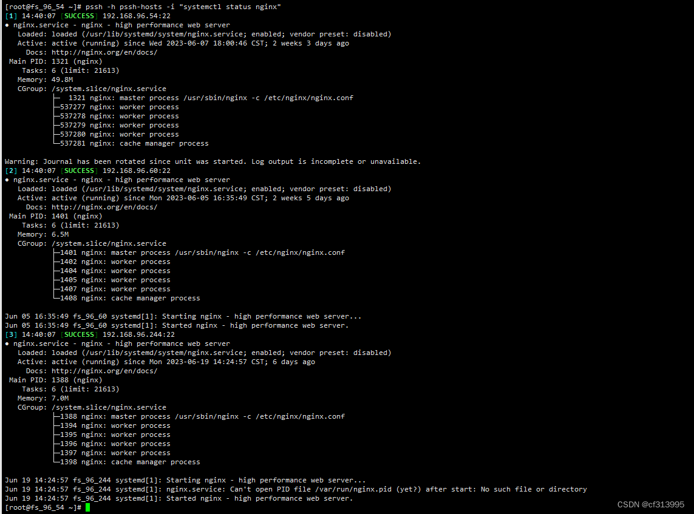
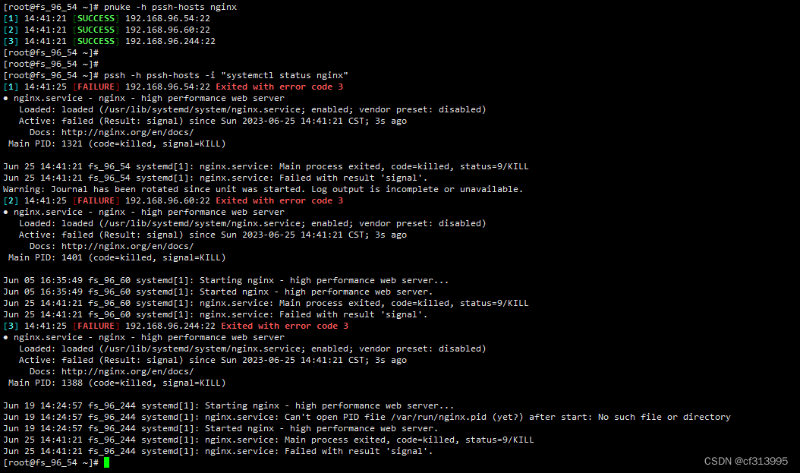

---
tags:
  - ansible
  - pssh
  - 自动化
---

# 自动化工具pssh和ansible

参考文档


[在多台服务器上运行相同命令(一)、pssh、ansible、自定义脚本-CSDN博客](https://blog.csdn.net/cf313995/article/details/131374574?ops_request_misc=&request_id=&biz_id=102&utm_term=pssh&utm_medium=distribute.pc_search_result.none-task-blog-2~all~sobaiduweb~default-1-131374574.nonecase&spm=1018.2226.3001.4187)

#### <font style="color:rgb(79, 79, 79);">文章目录</font>
+ [<font style="color:rgba(0, 0, 0, 0.85);">PSSH</font>](https://blog.csdn.net/cf313995/article/details/131374574?ops_request_misc=&request_id=&biz_id=102&utm_term=pssh&utm_medium=distribute.pc_search_result.none-task-blog-2~all~sobaiduweb~default-1-131374574.nonecase&spm=1018.2226.3001.4187#PSSH_2)
    - [<font style="color:rgba(0, 0, 0, 0.85);">安装</font>](https://blog.csdn.net/cf313995/article/details/131374574?ops_request_misc=&request_id=&biz_id=102&utm_term=pssh&utm_medium=distribute.pc_search_result.none-task-blog-2~all~sobaiduweb~default-1-131374574.nonecase&spm=1018.2226.3001.4187#_10)
    - [<font style="color:rgba(0, 0, 0, 0.85);">使用</font>](https://blog.csdn.net/cf313995/article/details/131374574?ops_request_misc=&request_id=&biz_id=102&utm_term=pssh&utm_medium=distribute.pc_search_result.none-task-blog-2~all~sobaiduweb~default-1-131374574.nonecase&spm=1018.2226.3001.4187#_16)
        * [<font style="color:rgba(0, 0, 0, 0.85);">(1)、定义一个文件，写入需要操作的机器，如pssh-hosts</font>](https://blog.csdn.net/cf313995/article/details/131374574?ops_request_misc=&request_id=&biz_id=102&utm_term=pssh&utm_medium=distribute.pc_search_result.none-task-blog-2~all~sobaiduweb~default-1-131374574.nonecase&spm=1018.2226.3001.4187#1psshhosts_17)
        * [<font style="color:rgba(0, 0, 0, 0.85);">(2)、pssh执行命令</font>](https://blog.csdn.net/cf313995/article/details/131374574?ops_request_misc=&request_id=&biz_id=102&utm_term=pssh&utm_medium=distribute.pc_search_result.none-task-blog-2~all~sobaiduweb~default-1-131374574.nonecase&spm=1018.2226.3001.4187#2pssh_28)
        * [<font style="color:rgba(0, 0, 0, 0.85);">(3)、参数含义</font>](https://blog.csdn.net/cf313995/article/details/131374574?ops_request_misc=&request_id=&biz_id=102&utm_term=pssh&utm_medium=distribute.pc_search_result.none-task-blog-2~all~sobaiduweb~default-1-131374574.nonecase&spm=1018.2226.3001.4187#3_35)
        * [<font style="color:rgba(0, 0, 0, 0.85);">(4)、pscp从96.54拷贝文件到其他机器</font>](https://blog.csdn.net/cf313995/article/details/131374574?ops_request_misc=&request_id=&biz_id=102&utm_term=pssh&utm_medium=distribute.pc_search_result.none-task-blog-2~all~sobaiduweb~default-1-131374574.nonecase&spm=1018.2226.3001.4187#4pscp9654_49)
        * [<font style="color:rgba(0, 0, 0, 0.85);">(5)、pslurp从其它机器下载文件到本地</font>](https://blog.csdn.net/cf313995/article/details/131374574?ops_request_misc=&request_id=&biz_id=102&utm_term=pssh&utm_medium=distribute.pc_search_result.none-task-blog-2~all~sobaiduweb~default-1-131374574.nonecase&spm=1018.2226.3001.4187#5pslurp_58)
        * [<font style="color:rgba(0, 0, 0, 0.85);">(6)、pnuke 杀死远程主机上的进程</font>](https://blog.csdn.net/cf313995/article/details/131374574?ops_request_misc=&request_id=&biz_id=102&utm_term=pssh&utm_medium=distribute.pc_search_result.none-task-blog-2~all~sobaiduweb~default-1-131374574.nonecase&spm=1018.2226.3001.4187#6pnuke__75)
+ [<font style="color:rgba(0, 0, 0, 0.85);">ansible</font>](https://blog.csdn.net/cf313995/article/details/131374574?ops_request_misc=&request_id=&biz_id=102&utm_term=pssh&utm_medium=distribute.pc_search_result.none-task-blog-2~all~sobaiduweb~default-1-131374574.nonecase&spm=1018.2226.3001.4187#ansible_87)
    - [<font style="color:rgba(0, 0, 0, 0.85);">安装</font>](https://blog.csdn.net/cf313995/article/details/131374574?ops_request_misc=&request_id=&biz_id=102&utm_term=pssh&utm_medium=distribute.pc_search_result.none-task-blog-2~all~sobaiduweb~default-1-131374574.nonecase&spm=1018.2226.3001.4187#_88)
    - [<font style="color:rgba(0, 0, 0, 0.85);">使用</font>](https://blog.csdn.net/cf313995/article/details/131374574?ops_request_misc=&request_id=&biz_id=102&utm_term=pssh&utm_medium=distribute.pc_search_result.none-task-blog-2~all~sobaiduweb~default-1-131374574.nonecase&spm=1018.2226.3001.4187#_97)
        * [<font style="color:rgba(0, 0, 0, 0.85);">(1)、安装完后，在/etc/ansible/目录下生成三个主要的文件或目录</font>](https://blog.csdn.net/cf313995/article/details/131374574?ops_request_misc=&request_id=&biz_id=102&utm_term=pssh&utm_medium=distribute.pc_search_result.none-task-blog-2~all~sobaiduweb~default-1-131374574.nonecase&spm=1018.2226.3001.4187#1etcansible_99)
        * [<font style="color:rgba(0, 0, 0, 0.85);">(2)、添加节点，在/etc/ansible/hosts文件中添加需要被管理的服务器节点</font>](https://blog.csdn.net/cf313995/article/details/131374574?ops_request_misc=&request_id=&biz_id=102&utm_term=pssh&utm_medium=distribute.pc_search_result.none-task-blog-2~all~sobaiduweb~default-1-131374574.nonecase&spm=1018.2226.3001.4187#2etcansiblehosts_105)
        * [<font style="color:rgba(0, 0, 0, 0.85);">(3)、建立互信环境</font>](https://blog.csdn.net/cf313995/article/details/131374574?ops_request_misc=&request_id=&biz_id=102&utm_term=pssh&utm_medium=distribute.pc_search_result.none-task-blog-2~all~sobaiduweb~default-1-131374574.nonecase&spm=1018.2226.3001.4187#3_115)
        * [<font style="color:rgba(0, 0, 0, 0.85);">(4)、测试连通性</font>](https://blog.csdn.net/cf313995/article/details/131374574?ops_request_misc=&request_id=&biz_id=102&utm_term=pssh&utm_medium=distribute.pc_search_result.none-task-blog-2~all~sobaiduweb~default-1-131374574.nonecase&spm=1018.2226.3001.4187#4_121)
        * [<font style="color:rgba(0, 0, 0, 0.85);">(5)、处理[WARNING]: sftp transfer mechanism failed</font>](https://blog.csdn.net/cf313995/article/details/131374574?ops_request_misc=&request_id=&biz_id=102&utm_term=pssh&utm_medium=distribute.pc_search_result.none-task-blog-2~all~sobaiduweb~default-1-131374574.nonecase&spm=1018.2226.3001.4187#5WARNING_sftp_transfer_mechanism_failed_133)
        * [<font style="color:rgba(0, 0, 0, 0.85);">(6)、ansible命令构成</font>](https://blog.csdn.net/cf313995/article/details/131374574?ops_request_misc=&request_id=&biz_id=102&utm_term=pssh&utm_medium=distribute.pc_search_result.none-task-blog-2~all~sobaiduweb~default-1-131374574.nonecase&spm=1018.2226.3001.4187#6ansible_143)
        * [<font style="color:rgba(0, 0, 0, 0.85);">(7)、playbook</font>](https://blog.csdn.net/cf313995/article/details/131374574?ops_request_misc=&request_id=&biz_id=102&utm_term=pssh&utm_medium=distribute.pc_search_result.none-task-blog-2~all~sobaiduweb~default-1-131374574.nonecase&spm=1018.2226.3001.4187#7playbook_183)
+ [<font style="color:rgba(0, 0, 0, 0.85);">自定义脚本</font>](https://blog.csdn.net/cf313995/article/details/131374574?ops_request_misc=&request_id=&biz_id=102&utm_term=pssh&utm_medium=distribute.pc_search_result.none-task-blog-2~all~sobaiduweb~default-1-131374574.nonecase&spm=1018.2226.3001.4187#_198)

## <font style="color:rgb(79, 79, 79);">PSSH</font>
```plain
全称是parallel-ssh，基于Python编写的并发在多台服务器上批量执行命令的工具。包括pssh，pscp，prsync，pnuke和pslurp。该项目包括psshlib，可以在自定义应用程序中使用。它相当于ansible的简化版，执行起来速度比ansible快，支持文件并行复制，远程命令执行，杀掉远程主机上的进程，杀手锏是文件并行复制。
	主要用法：
		pssh命令    在远程主机上执行本地命令或者脚本
        pscp命令    将本地文件拷贝至多个远端主机
        pslurp命令  从多台远程机器拷贝文件到本地
        pnuke命令  在远端主机杀进程
        prsync命令  使用rsync协议从本地计算机同步到远程主机

```

测试环境背景

```plain
A：centos7 192.168.227.140
B：centos7 192.168.227.148
C：debian12 192.168.227.142
```

### <font style="color:rgb(79, 79, 79);">安装</font>
首先在A机器上安装pssh

```plain
yum install epel-release
yum install pssh

```

### <font style="color:rgb(79, 79, 79);">使用</font>
#### <font style="color:rgb(79, 79, 79);">(1)、定义一个文件，写入需要操作的机器，如pssh-</font><font style="color:rgb(78, 161, 219) !important;">hosts</font>
```plain
vim pssh-hosts

```

<font style="color:rgb(77, 77, 77);">然后写入需要控制的机器</font>

```plain
192.168.227.148:22
192.168.227.142:22

```

### <font style="color:rgb(79, 79, 79);">(2)、</font>_<font style="color:#DF2A3F;">pssh执行命令</font>_
```bash
pssh -h pssh-hosts -l root -i "echo "Hello World""
# 因为已经是互信环境，所以不需要输入密码

[root@localhost ~]# pssh -h pssh-hosts -l root -i "ls"
[1] 15:46:52 [SUCCESS] 192.168.227.148:22
anaconda-ks.cfg
kernel-lt-5.4.278-1.el7.elrepo.x86_64.rpm
[2] 15:46:52 [SUCCESS] 192.168.227.142:22
kejilion.sh
pass-hosts
[root@localhost ~]# 


```


#### <font style="color:rgb(79, 79, 79);">(3)、参数含义</font>
```plain
-h -–hosts 主机文件列表，内容格式[user@]host[:port]
-l -–user 登录使用的用户名
-p -–par 并发的线程数【可选】
-t --timeout 超时时间【可选】
-v --verbose 输出详细信息【可选】

```

<font style="color:rgb(77, 77, 77);">仅包含在pslurp里的</font>

```plain
-L --localdir 下载文件的保存目录

```

### <font style="color:rgb(79, 79, 79);">(4)、</font>_<font style="color:#DF2A3F;">pscp从96.54拷贝文件到其他机器</font>_
```bash

pscp.pssh -h pssh-hosts -l root pssh-hosts /tmp
# 拷贝pssh-hosts文件到其他机器的/tmp目录
# pscp从本地拷贝到远程，所以先写本地的某个文件或目录，再写远程的目录

[root@localhost /]# pscp.pssh -h /root/pssh-hosts -l root /2.txt /opt/
[1] 16:01:13 [SUCCESS] 192.168.227.148:22
[2] 16:01:13 [SUCCESS] 192.168.227.142:22
[root@localhost /]# 

```



#### <font style="color:rgb(79, 79, 79);">(5)、pslurp从其它机器下载文件到本地</font>
```plain
例如，先创建一个脚本，并将其传入到每个机器上，获取每个机器的hostname并写入到一个文件，然后将每个机器上的该文件下载到本地。

```

<font style="color:rgb(77, 77, 77);">准备：  
</font>

<font style="color:rgb(77, 77, 77);">在使用pssh</font>[<font style="color:rgb(77, 77, 77);">执行脚本</font>](https://so.csdn.net/so/search?q=%E6%89%A7%E8%A1%8C%E8%84%9A%E6%9C%AC&spm=1001.2101.3001.7020)<font style="color:rgb(77, 77, 77);">后，将每个机器的hostname写入到本地的某个文件了  
</font><font style="color:rgb(77, 77, 77);">  
</font><font style="color:rgb(77, 77, 77);">最后使用pslurp将其</font>[<font style="color:rgb(77, 77, 77);">拷贝到</font>](https://so.csdn.net/so/search?q=%E6%8B%B7%E8%B4%9D%E5%88%B0&spm=1001.2101.3001.7020)<font style="color:rgb(77, 77, 77);">本地的某个目录  
</font>

```plain
pslurp -h pssh-hosts -L /a /tmp/1.txt 1.txt
# 将每个节点上的/tmp/1.txt下载到本地的a目录里
# pslurp从远程下载到远程，所以先写远程的某个文件或目录，再写本地的目录


```



### <font style="color:rgb(79, 79, 79);">(6)、pnuke 杀死远程主机上的进程</font>
<font style="color:rgb(77, 77, 77);">例如杀死每个机器的</font><font style="color:rgb(78, 161, 219) !important;">nginx</font><font style="color:rgb(77, 77, 77);">进程  
</font><font style="color:rgb(77, 77, 77);">查看每个节点的nginx的状态  
</font><font style="color:rgb(77, 77, 77);">  
</font><font style="color:rgb(77, 77, 77);">执行命令</font>

```plain
pnuke -h pssh-hosts nginx


```

<font style="color:rgb(77, 77, 77);">查看效果  
</font><font style="color:rgb(77, 77, 77);">  
</font><font style="color:rgb(77, 77, 77);">(7)、prsync跟rsync使用差不多，略过。</font>


> 更新: 2024-11-12 16:07:06  
> 原文: <https://www.yuque.com/xianzhou-eiffx/aklhoc/kvp8mxnm9a5q0lxg>